# Claude Harness

[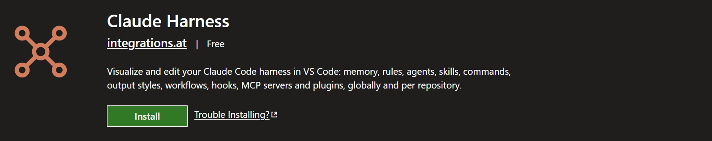](https://marketplace.visualstudio.com/items?itemName=integrations-at.claude-harness)

**See what your harness does, then change it.**

Claude Harness is a first-class tool for harness engineering, a VS Code editor for your whole Claude Code harness: memory, rules, agents, skills, commands, output styles, workflows, hooks, MCP servers and plugins, globally and per repository. It reads the session transcripts Claude Code already writes, so every part of the harness shows what it did and what it cost.

Replay a session to any checkpoint, see what each agent and skill cost, build plugins from your skills with Claude, and open every view as an `@harness` mention.

Best of all: once you have visualized and configured a scenario, you continue the task in a Claude terminal that opens with that context already filled in.

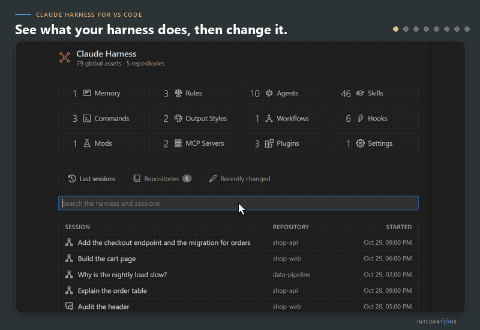

[Watch the film as MP4](https://github.com/alexander-kastil/claude-harness/blob/master/docs/images/harness-demo.mp4)

*The Claude actions in the film run in your terminal on your own Claude plan. Claude Harness charges nothing on top.*

## Quick start

Install Claude Harness: it opens on the `~/.claude` you already have.

1. Open the Extensions view (Ctrl+Shift+X), search for **Claude Harness**, and click **Install**. You can also run `code --install-extension integrations-at.claude-harness` in a terminal.
2. Click **Claude Harness** in the status bar, or its icon in the activity bar. The main window opens, and the side bar keeps the view you had open.
3. Pick an item in the sidebar to view and edit it. The global harness is read from `~/.claude`.

> Note: Claude Harness needs Claude Code and VS Code 1.100 or newer. The global MCP server list comes from `claude mcp list`, so the `claude` command must be on your PATH.

## Why Claude Harness

A harness grows one rule, hook and skill at a time, and much of it loads into every session whether it helps or not. A few months in, nobody can say which parts still run, which ones only cost context, and why a session went the way it did.

Claude Harness reads the transcripts Claude Code already writes and sets them beside the files that shape them: you see what each part did, then change it in the same place. Nothing joins your sessions, no hook, proxy or server.

| Feature | What it does |
| --- | --- |
| [See how a session ran](#see-how-a-session-ran) | Know what a session cost, see how its agents ran in six views, and restore files to any checkpoint |
| [Find what never runs](#find-what-never-runs) | See which agents, skills, hooks and rules ran, fired or loaded in your sessions, and which never did |
| [Keep the harness lean](#keep-the-harness-lean) | Find oversized skills, retire duplicate copies and repoint dead lines in CLAUDE.md |
| [Edit everything in one place](#edit-everything-in-one-place) | Change all twelve kinds, globally or per repository, in one tree with typed fields |
| [Plugin Hunter](#build-with-claude) | Tell Claude which skills and agents you have, and get a plugin proposed, created and installed |
| [Browser Automation Hunter](#build-with-claude) | Turn a browser procedure you repeat into a kept one, prototyped on the desktop and optimized in code |
| [Drawings](#build-with-claude) | See how any element connects to a session and in what order it runs |
| [Continue Cowork work in Code](#continue-cowork-work-in-code) | Pick up a desktop chat or Cowork session in a Claude terminal in your repo |
| [Keep plugins current](#keep-plugins-current) | See which plugins have a newer version and update them all after one confirm |
| [Command line and @harness mentions](#command-line-and-harness-mentions) | Run `harness` commands and `.harness` scripts, or hand a view to Claude as an `@harness` mention |

## See how a session ran

The session page reads Claude Code's session and subagent JSONL transcripts. Cost comes from each message's input, cache-write, cache-read and output tokens at API list prices. Under the cost and the KPIs, **How the work ran** has six views behind one toggle bar; click a lane or a node for that agent's brief, report, tools and tokens.

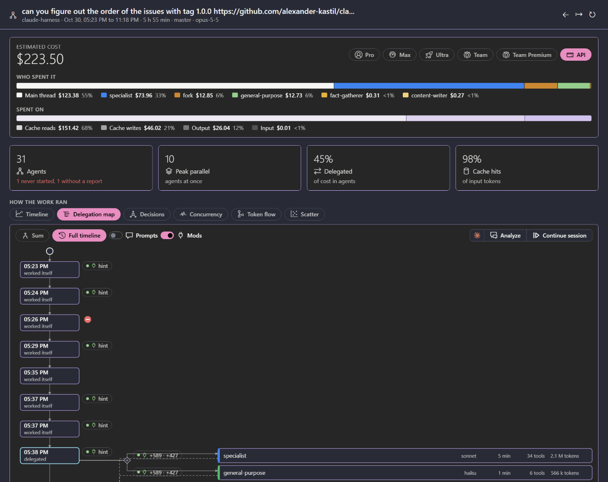

| View | Shows |
| --- | --- |
| Timeline | When each agent ran, beside your prompts and the events of your hooks |
| Delegation map | Who started which agent, with its tokens; a red stop sign marks a tool call a hook or mod denied |
| Decisions | What happened after each prompt: delegated, worked itself, followed up an agent, or answered |
| Concurrency | How many agents ran at the same time, with the peak marked |
| Token flow | The tokens from the session through the main thread and each agent type to the outcome |
| Scatter | Each agent by run time and tokens, so the slow or costly ones stand out |

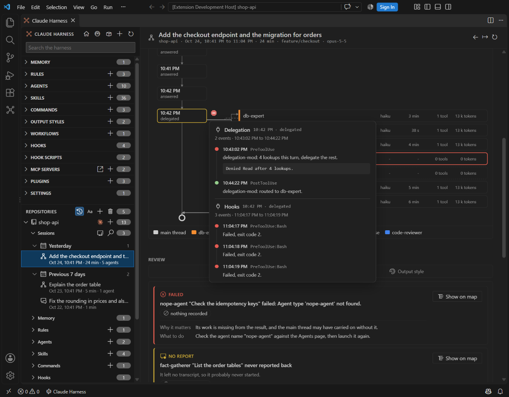

- **Checkpoints:** a ring round a prompt in the Timeline marks one. Click it for the files changed since, each in a side-by-side diff. **Restore files to here** puts them back after a card that names every file; **Rewind the conversation** continues the session in a terminal, where Claude's own rewind takes it back to the prompt.
- **Findings:** failed or silent agents, stopped runs, general-purpose runs where one of your agents fits, and failing hooks, each with its token cost and what to do.
- **Cost per agent type and model:** the **Models** tab of a repo page sums the last 7 days of each account by model and by agent type, with the share of the weekly limit on a plan.

## Find what never runs

| Tab | On | Shows |
| --- | --- | --- |
| Used in | Agents, skills, commands, plugins, output styles | The sessions that used it; presets list what never ran |
| Fired in | Hooks, MCP tools | Runs, exit codes and durations; call counts per tool |
| Loaded in | Rules, CLAUDE.md | The sessions that loaded it, including path-scoped rules that never matched |

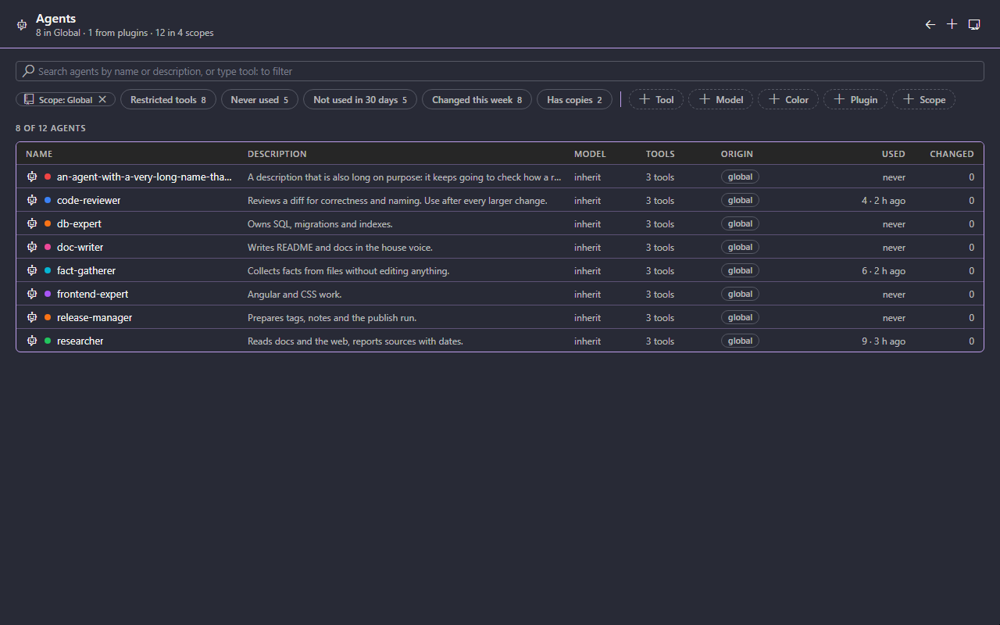

## Keep the harness lean

- **Skill size and context cost:** a Size card flags descriptions over 200 tokens or 1024 characters and SKILL.md files over 500 lines, ranked by the context they cost; each finding has its own **Resolve with Claude**.
- **Consolidate duplicates:** a copy identical to Global is retired with a backup; one that differs opens a side-by-side compare, or Merge with Claude.
- **CLAUDE.md lenses:** dead pointers, such as an agent that no longer exists, with a quick fix to repoint or drop the line.
- **Effective harness:** the memory, rules, plugins and hooks a session in a repo loads, with the rules that were not loaded and the hooks that fail.

## Edit everything in one place

Global `~/.claude`, each repository's `.claude/` and plugin-shipped items (read-only) sit in one tree, all twelve kinds, with frontmatter as typed fields and a tool picker. The GitHub Repo overview puts every repository in one table, with a search.

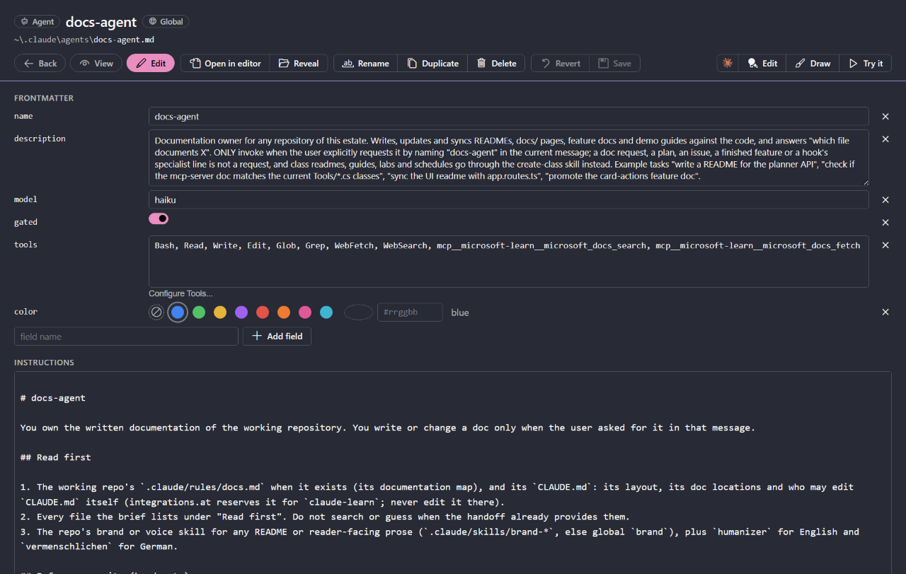

## Build with Claude

- **Plugin Hunter:** talk to Claude about the skills and agents you have, and it proposes a plugin. Open it with the telescope button in the Claude group of the Plugins page or the overview. Create writes the plugin into a marketplace folder of yours, installs it and retires the copies you tick, with a backup; the History tab keeps every card with its chat.
- **Browser Automation Hunter:** the browser procedures you repeat, such as DNS records, admin center settings or a publisher setup, prototyped on the desktop and then optimized in code. Pick a kept procedure or describe a new one; Claude proposes its steps and how to keep it (API script, command line, guided browser run or a tool), you mark the manual steps, and Create writes it into your browser-automations skill. Open it next to Plugin Hunter in the Claude group of the overview.
- **Drawings:** one press of **Draw with Claude** draws any skill, agent, command, workflow, hook, MCP server, plugin or marketplace twice: the Harness view, how its parts connect to a session, and the Process view, what runs in which order, drawn for its kind (for a marketplace, how its plugins hand work to each other). A toggle switches between them.
- **Claude actions in your terminal:** Edit, Slim, Try it, Analyze, Continue and Merge with Claude start your `claude` CLI in a VS Code terminal with the prompt and the measured context filled in, after a confirm card. The terminals open in the editor area and run `claudeHarness.terminal.command`; Ctrl+F1 opens a new one. The runs count against your Claude plan, Claude Harness adds no charge, and the status bar shows your 5-hour and weekly limits live. See [Settings](docs/settings.md#terminals).

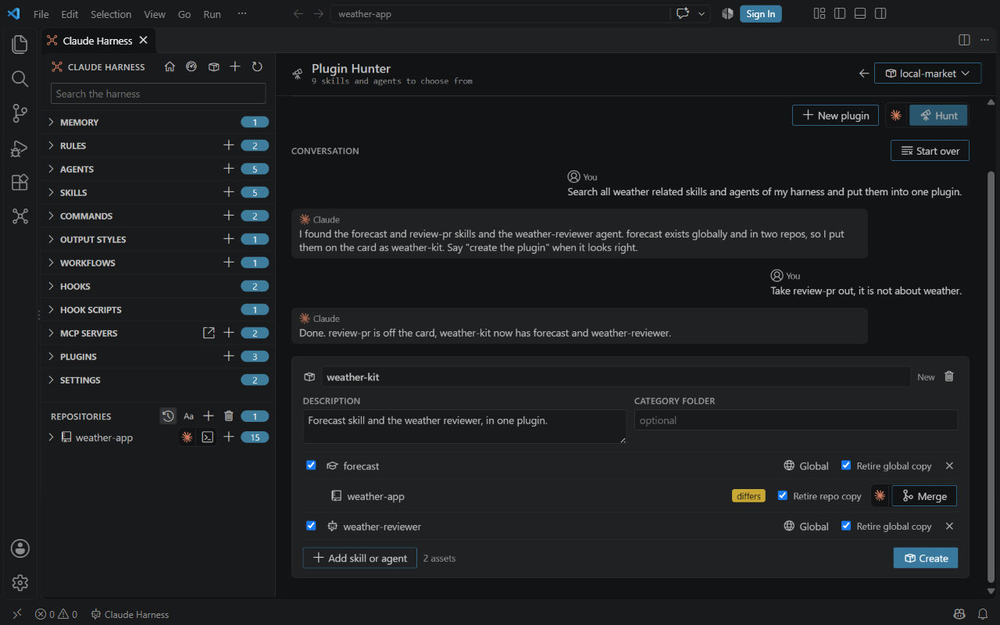

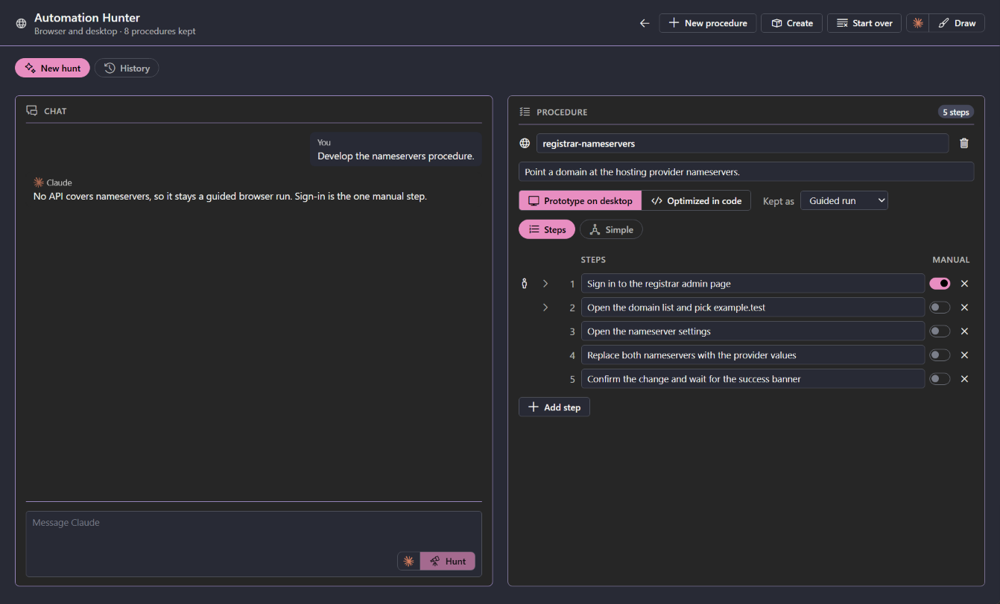

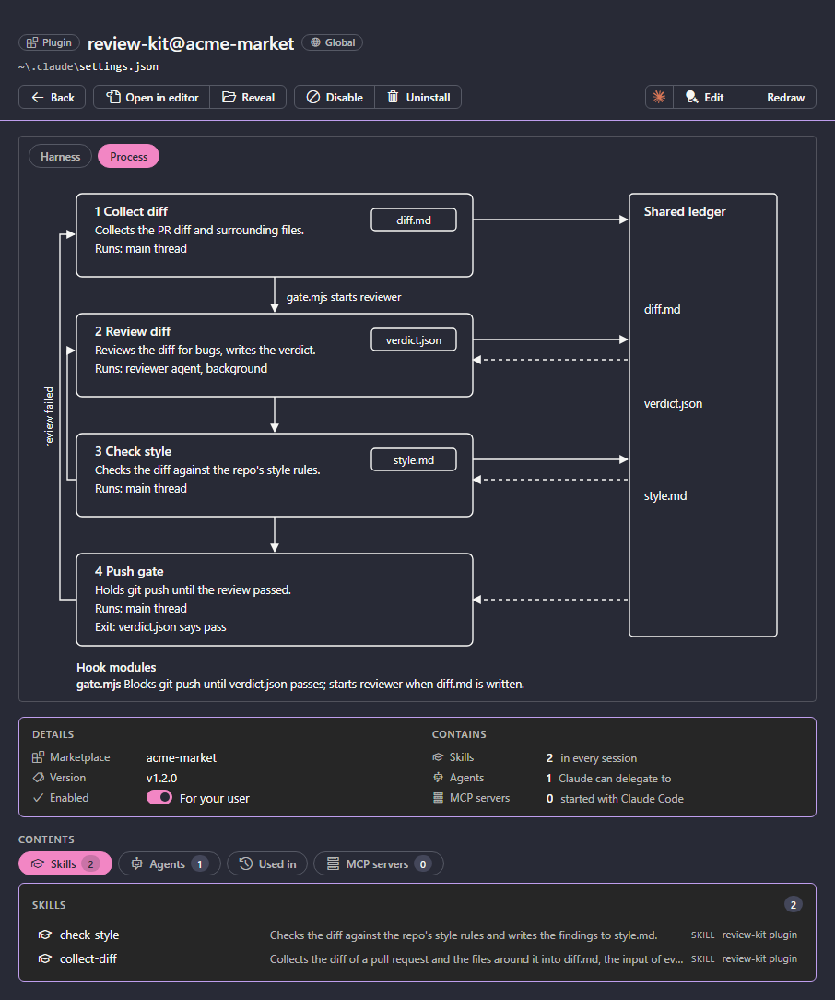

## Continue Cowork work in Code

Work that started in Cowork, in the Claude desktop app or on claude.ai, continues in Claude Code through **Handover**: in the Cowork region of the sidebar, or with **Cowork Handover** in the Claude group of the overview.

- **Inbox:** the desktop app's chats on this PC, your Cowork sessions on claude.ai, the app files of the last two weeks in Downloads, or a pasted claude.ai artifact link.
- **Handover card:** **Draft with Claude** proposes the task in one sentence, the rules the chat set, what exists and what is still to write. You tick the files that come along (a missing one is flagged, with **Locate**) and pick the target repository and folder.
- **Continue in terminal:** a confirm card lists every file and the first prompt. The files and a `CONTEXT.md` land in `handover/<chat>/` of the repository, and Claude Code opens there with that prompt.

The chats of claude.ai itself are not on your PC and the Claude Code sign-in cannot read them, and an artifact link's content needs a browser sign-in: paste its text into the card's snapshot.

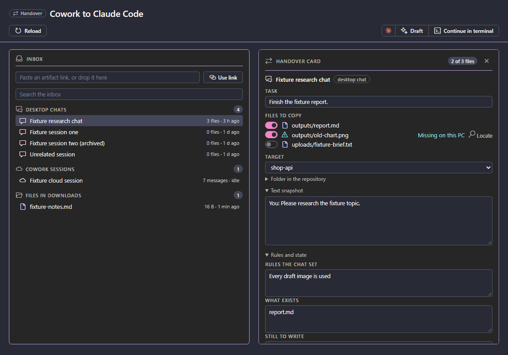

## Keep plugins current

The Marketplaces section of the sidebar lists every marketplace with its plugin count and how many plugins have a newer version than the one installed. A marketplace page shows its source, its plugins with the installed and the latest version, and its drawings. **Sync all** updates every plugin that is ahead after one confirm card.

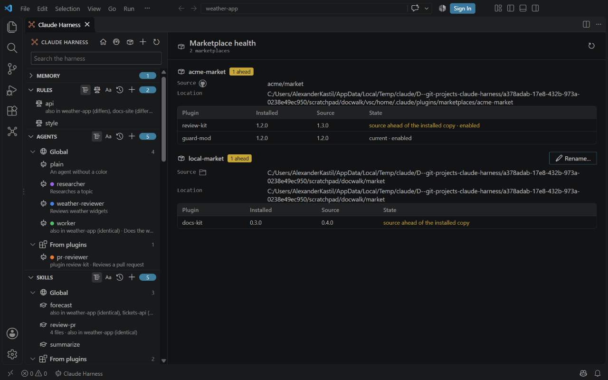

## Command line and @harness mentions

Run **Claude Harness: Install 'harness' Command Line** once to put `harness` on your PATH, with Tab completion in PowerShell and Git Bash. In Claude Code, with the [harness plugin](#install-the-harness-plugin) installed, type `@h` in a prompt for a view such as `@harness:usage`: when you send the prompt, the view runs and Claude reads its output as context.

A second example is `harness sessions open --session <id>` with its mention `@harness:session-analyze`: typed in a Claude Code prompt, it opens the current session on the panel's session page.

| Area | Commands |
| --- | --- |
| Read the harness | `inventory`, `consolidate`, `agents list`, `agents route`, `marketplaces`, `repos`, `check`, `sync`, `sources` |
| Sessions | `usage`, `delegation`, `sessions`, `sessions open`, `mods`, `time`, `lessons` |
| Plugins | `hunt catalog`, `hunt plan`, `hunt create`, `hunt add`, `plugins rename`, `marketplaces rename`, `sync plugin` |
| Skills and copies | `consolidate retire`, `skills move`, `split`, `put`, `remove`, `rename`, `repoint`, `fix-paths`, `sync apply` |
| Build a harness | `generate`, `add`, `new`, `update`, `validate`, `run` |
| Media | `media doctor` |

Add `--dry-run` to a command that writes to print each action instead, and `--json` for one object whose last key is `applied`. Exit codes: 0 done, 1 error or problems found, 2 bad arguments. See [Command line](docs/command-line.md) and [Type-ahead](docs/type-ahead.md).

A `.harness` script lists build commands, one per line, in a file you keep in the repo and review. `harness validate` checks it and writes nothing, and `harness run` applies it step by step:

```text
# poems.harness: a poem writer and a poem reviewer
repo D:/demo/poems
generate agent poem-writer --model sonnet --tools Read,Write,Edit --description "Writes a short poem on a given theme into poems/"
generate agent poem-reviewer --model haiku --tools Read,Grep --description "Reviews a poem for meter, rhyme and imagery"
generate rule poem-style --paths poems/** --from templates/rules/poem-style.md
generate command review-poem --description "Review the newest poem" --from templates/commands/review-poem.md
```

See [Harness scripts](docs/harness-scripts.md) for the format.

### Install the harness plugin

The harness plugin adds `@harness:` mentions to the Claude prompt box, with type-ahead, for the views that only read. It needs Claude Harness 0.9.0 or later, and its version always matches the extension's. It ships from this repository as the `claude-harness` marketplace.

In Claude Code:

```text
/plugin marketplace add alexander-kastil/claude-harness
/plugin install harness@claude-harness
/reload-plugins
```

Or from a shell:

```bash
claude plugin marketplace add alexander-kastil/claude-harness
claude plugin install harness@claude-harness
```

## Features

| Feature | Summary |
| --- | --- |
| [Main window](docs/main-window.md) | Browses the global harness and each repository in one window, with search and an overview |
| [Harness kinds](docs/harness-kinds.md) | The twelve kinds of harness items, where they are stored and which ones you can change |
| [Editing](docs/editing.md) | Edits frontmatter and instructions, saves or reverts, and creates, renames, duplicates or deletes items |
| [Repositories](docs/repositories.md) | Shows the harness of each repo, and adds or removes repos |
| [Sessions](docs/sessions.md) | Lists the Claude Code sessions of each repo, with a search and a session page for cost, agents, delegation, findings and the events of mods, plus where each element was used and the last 7 days of cost |
| [CLAUDE.md lenses](docs/claude-md-lenses.md) | Flags dead pointers in CLAUDE.md and rules files, with quick fixes |
| [Effective harness](docs/effective-harness.md) | Lists the memory, rules, plugins and hooks that a session in a repo loads |
| [Duplicates](docs/duplicates.md) | Finds copies of an item across scopes and plugins, compares them, and retires repo copies |
| [Share and Import](docs/commands.md#share-and-import) | Packs an agent, skill, command, rule, plugin, MCP server or hook into a file in your Downloads folder, and imports one that someone shared, with a backup of what it replaces |
| [Sync](docs/duplicates.md#sync) | Brings a repo copy in step with Global, a plugin with its marketplace, a skill with its source, and an MCP server with its other copies |
| [Bulk-edit guard](docs/bulk-edits.md) | Leaves out repos with uncommitted harness files, busy sessions or stale worktree copies before a bulk change |
| [GitHub Repo overview](docs/repos-overview.md) | One table of every repo, with a search by name or path, its lines, plugins and copies |
| [Rules editor](docs/rules-editor.md) | Shows which files a rule's paths match |
| [Marketplace health](docs/marketplace-health.md) | Lists marketplaces and plugins, flags sources ahead of the installed copy, syncs every plugin that is ahead after one card, renames directory marketplaces, and gives each marketplace its own page, listed under Marketplaces in the sidebar |
| [Configure Tools](docs/configure-tools.md) | Picks the tools an agent, skill or command may use |
| [MCP servers](docs/mcp-servers.md) | Lists MCP servers with their source and status, sorts them, shows their tools, and adds, copies or deletes them |
| [MCP switches](docs/mcp-toggles.md) | Turns an MCP server on or off for one repo or in every folder |
| [Plugins](docs/plugins.md) | Enables, disables, installs and uninstalls plugins, marks mods, builds a new plugin from your skills and agents with Plugin Hunter, and draws a plugin as a Harness and a Process view |
| [Skill sources](docs/skill-sources.md) | Adds skills from skills.sh or GitHub, checks them for a newer version, updates them in place, and moves a global skill into a repo |
| [Settings](docs/settings.md) | Sets the global harness folder, the repo lists, where Claude terminals open and which command starts them, the Claude usage item in the status bar and the list lengths, and edits the settings files |
| [Commands](docs/commands.md) | Every Claude Harness command, what it does and where to find it |
| [Command line](docs/command-line.md) | Runs inventory, consolidate, hunt, agents, usage, delegation and media checks from a terminal, with `--json` for scripts, builds a harness with `generate`, `add`, `new` and `update`, and hands the views to Claude as `@harness:` mentions |
| [Harness scripts](docs/harness-scripts.md) | Runs a `.harness` file of build lines that adds agents, rules, skills, commands, hooks, MCP servers and plugins to a repo, checked by `validate` before `run` applies it |
| [Type-ahead](docs/type-ahead.md) | Offers the next word for `@harness:` mentions in the Claude Code prompt, for `harness` commands in a terminal, and for `.harness` scripts in VS Code |

Provider features appear when a harness standard provider plugin is installed.

## Contributing

To contribute from a fork, follow the steps in [CONTRIBUTE.md](CONTRIBUTE.md).

## License

Claude Harness License 1.0: free for internal use, no redistribution or derived works. (c) 2026 Alexander Kastil, [integrations.at](https://integrations.at). See [LICENSE](LICENSE).
