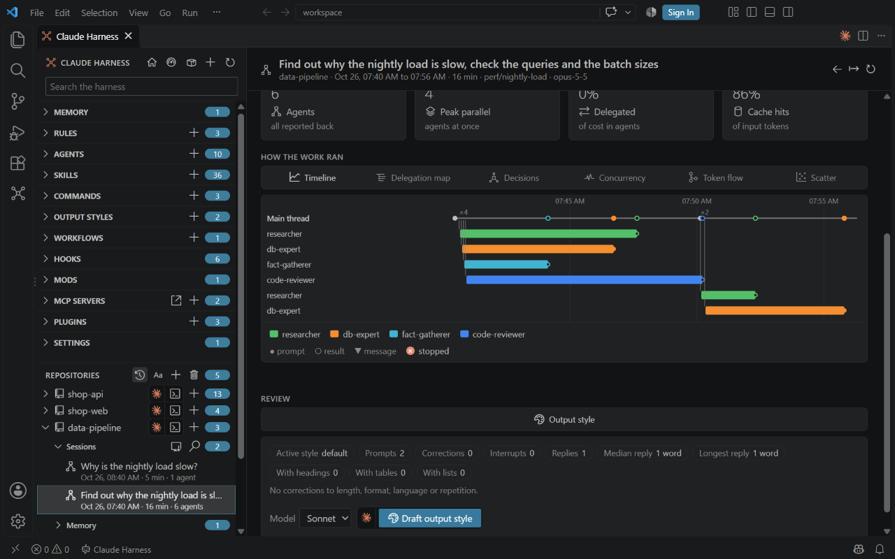
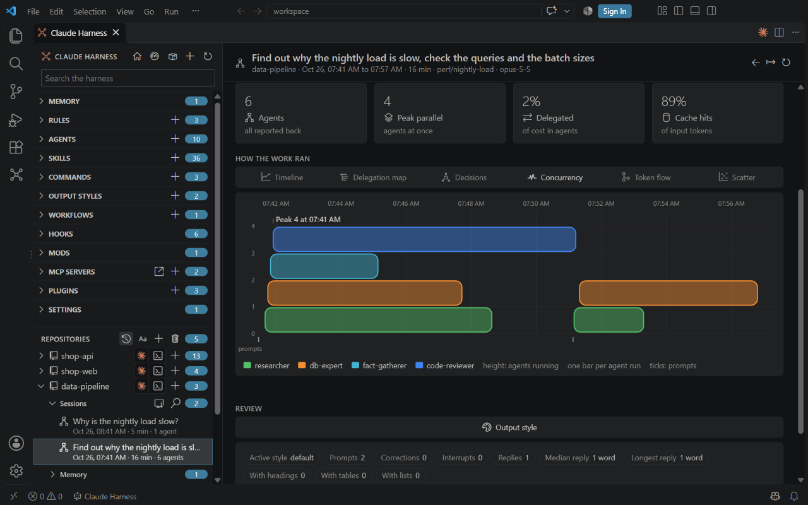
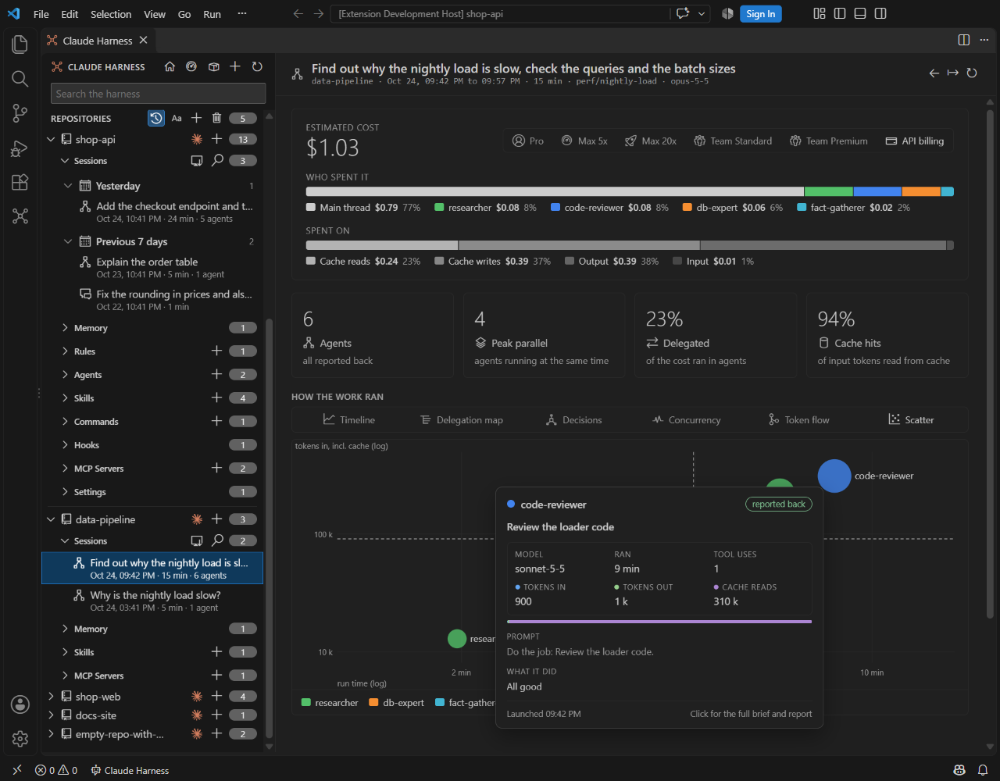
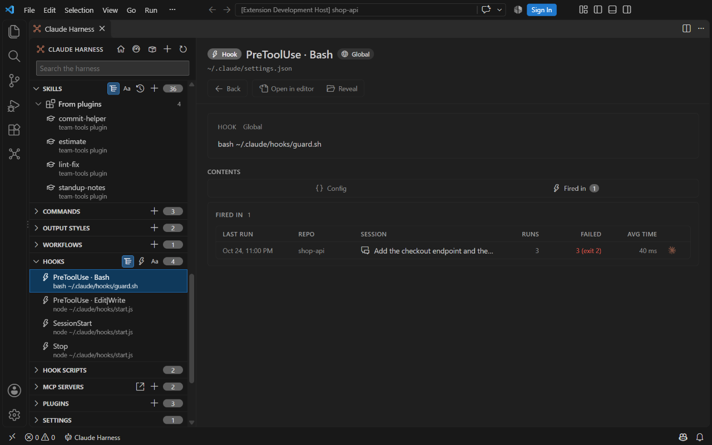
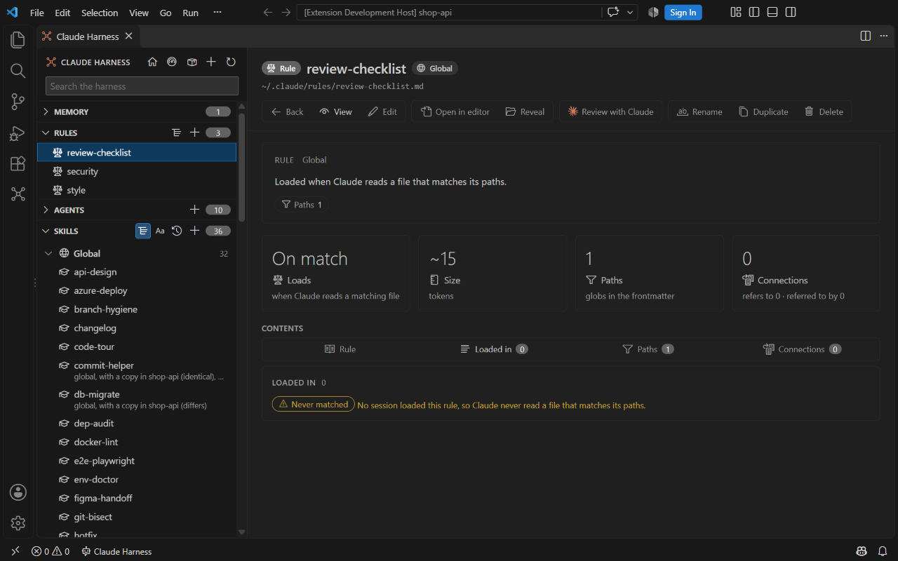
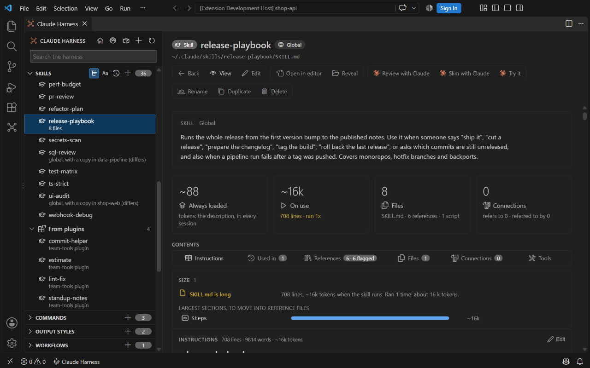
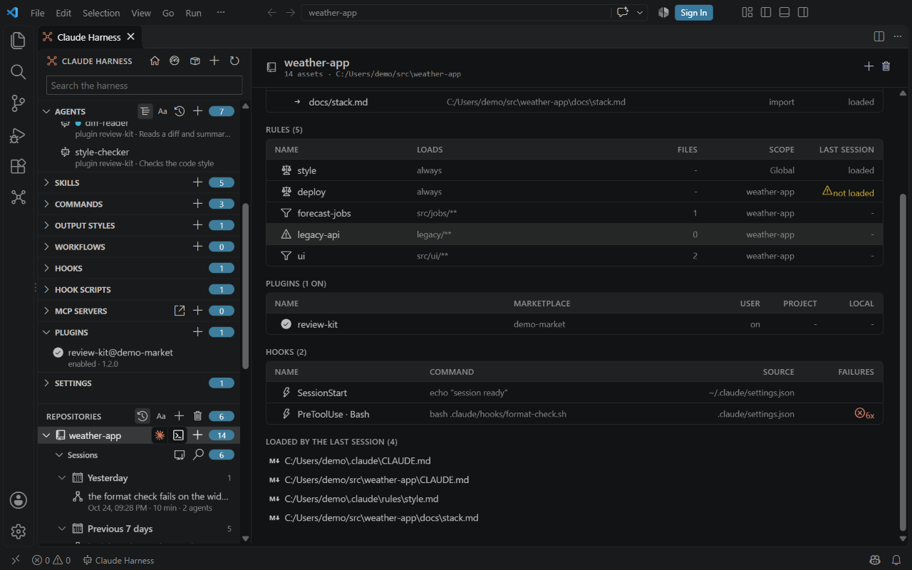
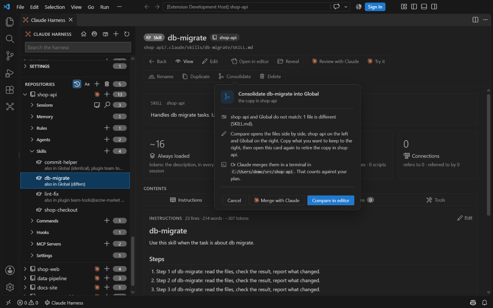
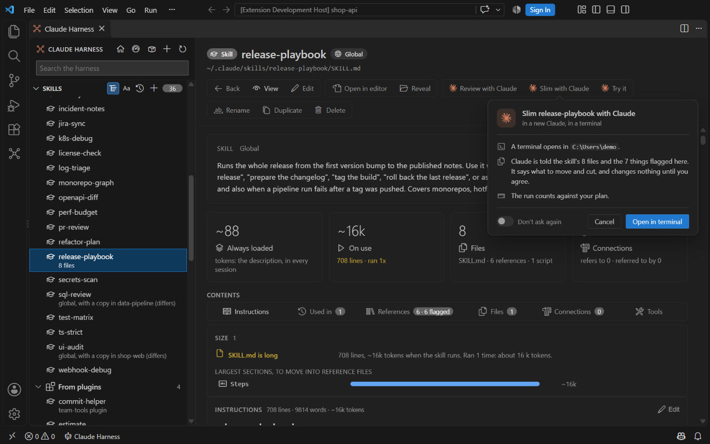

# Claude Harness

**See what your harness does, then change it.**

Claude Harness is a VS Code editor for your whole Claude Code harness: memory, rules, agents, skills, commands, output styles, workflows, hooks, MCP servers and plugins, globally and per repository. It reads the session transcripts Claude Code already writes, so every part of the harness shows what it did and what it cost.

*The Claude actions in the film run in your terminal on your own Claude plan. Claude Harness charges nothing on top.*

## Why Claude Harness

A harness grows one rule, hook and skill at a time. After a few months it is hard to say which parts still run, which ones load into every session, and why a session cost what it did. The files describe what should happen; the transcripts record what did. Claude Harness puts the two side by side.

### Execution analysis of every session

Reads Claude Code's session and subagent JSONL transcripts, with no hook, proxy or server to install, and shows how each session actually ran. Cost per session comes from each message's input, cache-write, cache-read and output tokens at API list prices. Below the cost and the KPIs, a **How the work ran** section has six views of the delegation behind one toggle bar. Click a lane or a node in a view to see that agent's brief, report, tools and tokens.

#### Timeline

When each agent ran, next to your prompts and the events of your hooks. Four agents started in one turn show as four overlapping lanes.

#### Delegation map

Who started which agent, with every agent launch and its tokens, and which agents worked as a team. Sum mode adds the runs up by type; Full timeline branches each prompt into the agents it started. A red stop sign on a step marks a tool call that a hook or mod denied; hover it for what was denied and the hook events around it.

#### Decisions

What happened after each prompt: delegated, worked itself, followed up an agent, or answered.

#### Concurrency

The agents that ran at the same time. Each agent run is one bar, so the height is the number of agents running, and the peak is marked.

#### Token flow

The tokens from the session, through the main thread and each agent type, to the outcome: reported back, no report or failed.

#### Scatter

Each agent by run time and tokens. Dot area is the agent's cost, dashed lines are medians, and both scales are logarithmic, so the slow or costly agents stand out.

Hover a dot for the agent's model, run time, tokens, prompt and report.

#### Findings with their token cost

Failed or silent agents, stopped runs, general-purpose runs where one of your agents fits, and failing hooks, each with its token cost and what to do.

### Used in: what never runs

Used in for agents, skills, commands, plugins and output styles. Presets list what never runs.

### Fired in: hook runs and exit codes

Fired in for hooks, with run counts, exit codes and durations; call counts per MCP tool.

### Loaded in: rules that never matched

Loaded in for rules and CLAUDE.md, including path-scoped rules that never matched.

### Skill size and context cost

A Size card flags skill descriptions over 200 tokens or 1024 characters and SKILL.md files over 500 lines, ranked by the context they cost across sessions.

### One editor for all twelve kinds, across scopes

Global `~/.claude`, each repository's `.claude/` and plugin-shipped items (read-only) in one tree, with frontmatter as typed fields and a tool picker.

### The effective harness of a repository

The memory, rules, plugins and hooks a session in a repo loads, with the rules that were not loaded and the hooks that fail.

### Lenses for dead pointers in CLAUDE.md

Lenses flag dead pointers in CLAUDE.md, such as an agent it names that no longer exists, with a quick fix to repoint or drop the line.

### Consolidate duplicate skills

Merges duplicate skills across scopes and plugins into one source. A copy identical to Global is retired with a backup; a copy that differs opens a side-by-side compare, or Merge with Claude.

### Plugin Hunter

Talk to Claude about the skills and agents you already have, and it proposes a plugin. Create writes the plugin into a marketplace folder of yours, installs it and retires the copies you tick, with a backup. The Enabled column of the Plugins page is a switch that enables or disables a plugin.

### Claude actions through your own CLI

Review, Slim, Try it, Analyze, Continue and Merge with Claude start your `claude` CLI in a VS Code terminal with the prompt and the measured context filled in; Analyze works on a copy of the session. Each opens a confirm card first. The runs count against your Claude plan, and Claude Harness adds no charge.

## Quick start

Install Claude Harness: it opens on the `~/.claude` you already have.

1. Open the Extensions view (Ctrl+Shift+X), search for **Claude Harness**, and click **Install**. You can also run `code --install-extension integrations-at.claude-harness` in a terminal.
2. Click **Claude Harness** in the status bar, or its icon in the activity bar. The main window opens.
3. Pick an item in the sidebar to view and edit it. The global harness is read from `~/.claude`.

> Note: Claude Harness needs Claude Code and VS Code 1.100 or newer. The global MCP server list comes from `claude mcp list`, so the `claude` command must be on your PATH.

## Features

| Feature | Summary |
| --- | --- |
| [Main window](docs/main-window.md) | Browses the global harness and each repository in one window, with search and an overview |
| [Harness kinds](docs/harness-kinds.md) | The twelve kinds of harness items, where they are stored and which ones you can change |
| [Editing](docs/editing.md) | Edits frontmatter and instructions, saves or reverts, and creates, renames, duplicates or deletes items |
| [Repositories](docs/repositories.md) | Shows the harness of each repo, and adds or removes repos |
| [Sessions](docs/sessions.md) | Lists the Claude Code sessions of each repo, with a search and a session page for cost, agents, delegation, findings and the events of mods, plus where each element was used and the last 7 days of cost |
| [CLAUDE.md lenses](docs/claude-md-lenses.md) | Flags dead pointers in CLAUDE.md and rules files, with quick fixes |
| [Effective harness](docs/effective-harness.md) | Lists the memory, rules, plugins and hooks that a session in a repo loads |
| [Duplicates](docs/duplicates.md) | Finds copies of an item across scopes and plugins, compares them, and retires repo copies |
| [Share and Import](docs/commands.md#share-and-import) | Packs an agent, skill, command, rule, plugin, MCP server or hook into a file in your Downloads folder, and imports one that someone shared, with a backup of what it replaces |
| [Sync](docs/duplicates.md#sync) | Brings a repo copy in step with Global, a plugin with its marketplace, a skill with its source, and an MCP server with its other copies |
| [Bulk-edit guard](docs/bulk-edits.md) | Leaves out repos with uncommitted harness files, busy sessions or stale worktree copies before a bulk change |
| [Fleet overview](docs/fleet-overview.md) | One table of every repo, with its lines, plugins and copies |
| [Rules editor](docs/rules-editor.md) | Shows which files a rule's paths match |
| [Marketplace health](docs/marketplace-health.md) | Lists marketplaces and plugins, flags sources ahead of the installed copy, and renames directory marketplaces |
| [Configure Tools](docs/configure-tools.md) | Picks the tools an agent, skill or command may use |
| [MCP servers](docs/mcp-servers.md) | Lists MCP servers with their source and status, sorts them, shows their tools, and adds, copies or deletes them |
| [MCP switches](docs/mcp-toggles.md) | Turns an MCP server on or off for one repo or in every folder |
| [Plugins](docs/plugins.md) | Enables, disables, installs and uninstalls plugins, marks mods, and builds a new plugin from your skills and agents with Plugin Hunter |
| [Skill sources](docs/skill-sources.md) | Adds skills from skills.sh or GitHub, checks them for a newer version, updates them in place, and links a global skill into a repo |
| [Settings](docs/settings.md) | Sets the global harness folder and the repo lists the extension keeps, and edits the settings files |
| [Commands](docs/commands.md) | Every Claude Harness command, what it does and where to find it |

Provider features appear when a harness standard provider plugin is installed.

## Contributing

To contribute from a fork, follow the steps in [CONTRIBUTE.md](CONTRIBUTE.md).

## License

Claude Harness License 1.0: free for internal use, no redistribution or derived works. (c) 2026 Alexander Kastil, [integrations.at](https://integrations.at). See [LICENSE](LICENSE).
