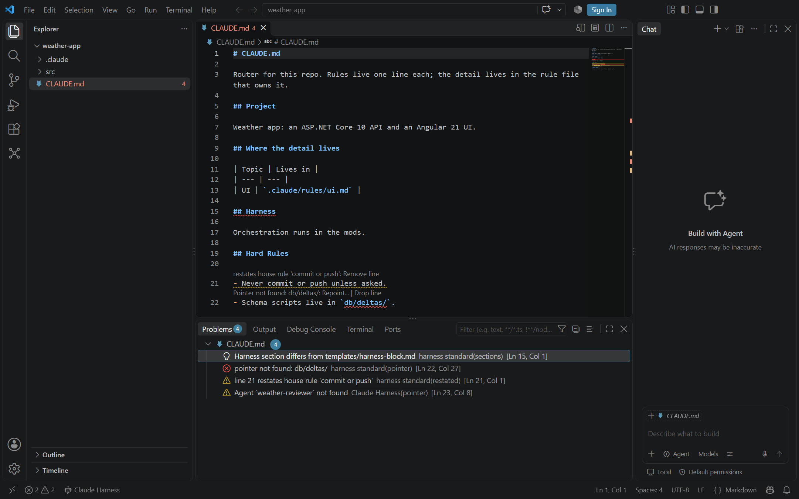

# CLAUDE.md lenses

<table width="100%" border="1" cellpadding="10" cellspacing="0">
<tr>
<td align="left"><a href="harness-standard.md">← Back to Harness standard</a></td>
<td align="center"></td>
<td align="right"><a href="effective-harness.md">→ Next: Effective harness</a></td>
</tr>
</table>

Claude Harness adds CodeLens lines and quick fixes to a repo's root `CLAUDE.md` and to its `.claude/rules/*.md` files. Each line names a problem and offers a fix. The problems come from the [harness standard](harness-standard.md) check and from a lookup of the names the file uses.

## Restated rules

A line that repeats a house rule shows a lens such as `restates house rule 'commit or push': Remove line`. Click **Remove line** to delete it. The quick fix on the lightbulb is also **Remove line**.

## Dead pointers

A pointer is a path, skill or agent named in backticks. A pointer that does not exist on disk shows a lens:

- `Pointer not found: db/deltas/: Repoint... | Drop line` for a path
- `Skill ... not found: Repoint... | Drop line` for a skill
- `Agent not found: weather-reviewer: Repoint... | Drop line` for an agent

Paths in `CLAUDE.md` come from the harness standard check. Skills and agents in `CLAUDE.md`, and every pointer in a rules file, are checked by Claude Harness. Skills of plugins from directory marketplaces count as existing.

**Repoint...** opens a list of the closest existing names or paths, and **Type a value...** at the end of the list. Choose one to replace the name in backticks. **Drop line** deletes the line.

## Boilerplate sections

A heading from the old template shows a lens that ends with `its rules belong in Working Method`. Click it to open the [harness standard](harness-standard.md).

## Quick fixes

Put the cursor on a flagged line and open the lightbulb. The menu offers:

| Problem | Quick fixes |
| --- | --- |
| Dead path, skill or agent | **Repoint to** each close name, and **Drop line** |
| Restated rule | **Remove line** |

The lenses refresh when you save the file.

---

<table width="100%" border="1" cellpadding="10" cellspacing="0">
<tr>
<td align="left"><a href="harness-standard.md">← Back to Harness standard</a></td>
<td align="center"><a href="#claude-md-lenses">↑ Back to top</a></td>
<td align="right"><a href="effective-harness.md">→ Next: Effective harness</a></td>
</tr>
</table>
