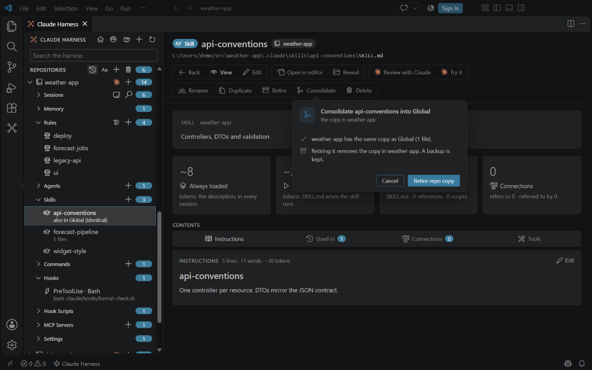

# Duplicates

<table width="100%" border="1" cellpadding="10" cellspacing="0">
<tr>
<td align="left"><a href="effective-harness.md">← Back to Effective harness</a></td>
<td align="center"></td>
<td align="right"><a href="bulk-edits.md">→ Next: Bulk-edit guard</a></td>
</tr>
</table>

Claude Harness finds copies of the same item in different scopes. A copy can be a rule, agent, skill, command, output style, workflow or hook script. It can sit in the global harness, in a repo, or in a plugin or directory marketplace. You can compare a copy with the original, and retire a repo copy that is identical to a global or plugin copy.

## What counts as a copy

Items with the same name are compared across all scopes. Each copy reads one of three states:

| State | Meaning |
| --- | --- |
| identical | The same file content. Line endings do not count. |
| nearly identical | Only whitespace or version lines differ. |
| differs | The content is different. |

A copy shows in the sidebar and tree as **also in Global (identical)**, and a global item that has a copy in a repo reads **global, with a copy in weather-app (identical)**, or with the state of the copy, for example **also in docs-kit (differs)**. **Compare with Copy...** on the tree's right-click menu opens the two files in the diff editor.

## Retire a copy

**Retire Copy** is the **Retire** button in the command bar of a repo skill or agent. It is offered only when a global or plugin copy is identical. Retiring does this:

1. Copies the file or skill folder to `repo-sync-backups/<yyyymmdd-hhmmss>/<repo>/<path>` in the global harness folder: `~/.claude`, or the folder set by `claudeHarness.root`.
2. Deletes it from the repo.

A confirmation card under the button shows the identical copy, the backup path and the file that goes. Started from a tree menu, it is a VS Code dialog. When the repo has uncommitted harness files, a busy Claude session or stale worktree copies, the confirmation also names them under **Careful**. Nothing else changes.

Retire is offered in every repo. A harness standard provider plugin can mark repos that keep their copies, and Retire is then hidden there.

## Consolidate

**Consolidate** moves a repo skill up to the place it comes from and retires the repo copy. It is the **Consolidate** button in the command bar of a repo skill, and the **Consolidate...** entry in the right-click menu of a repo skill row, in the sidebar and on the Skills type page. The whole skill folder counts, not only SKILL.md.

A card (a VS Code dialog from a menu) reads **Consolidate X into Global**, or into the plugin, and names what is different. When there is more than one target you choose on the card. The target is the source folder of the marketplace plugin that ships the skill, otherwise global.

| The repo copy is | What happens |
| --- | --- |
| Identical, nearly identical, or contained in the target | **Retire repo copy**: it is backed up as in [Retire a copy](#retire-a-copy), then deleted. |
| Different from the target | Merge it first: **Compare in editor** opens the two in the diff editor, the repo copy on the left, or **Consolidate with Claude** opens a terminal where Claude merges them. Then run Consolidate again, which retires it. |
| Only in the repo | **Move to global** moves it up. The move is refused when a skill of that name already exists there. |

The card has no **Don't ask again**, since it deletes the repo copy.

## Retire clean copies

**Retire Clean Copies...** lists every repo copy that has an identical global or plugin copy, all ticked. Clear the ones to keep, then confirm. Each copy is backed up to one timestamped folder first. The [bulk-edit guard](bulk-edits.md) can leave out repos with uncommitted harness files, busy sessions or stale worktree copies.

The **Delete** command still moves an item to the trash, as before. Retire does not use the trash.

---

<table width="100%" border="1" cellpadding="10" cellspacing="0">
<tr>
<td align="left"><a href="effective-harness.md">← Back to Effective harness</a></td>
<td align="center"><a href="#duplicates">↑ Back to top</a></td>
<td align="right"><a href="bulk-edits.md">→ Next: Bulk-edit guard</a></td>
</tr>
</table>
