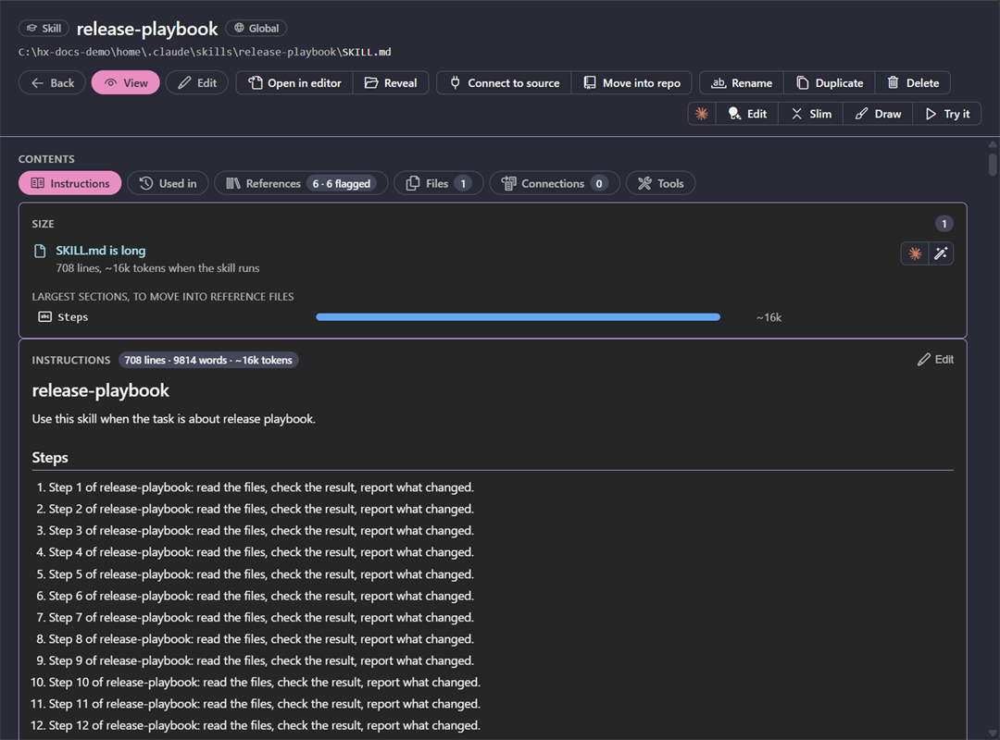
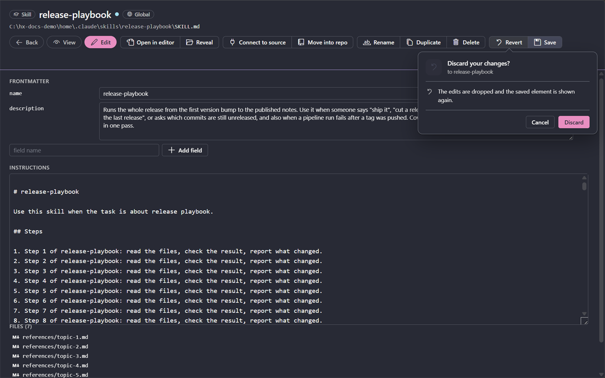

# Editing

<table width="100%" border="1" cellpadding="10" cellspacing="0">
<tr>
<td align="left"><a href="harness-kinds.md">← Back to Harness kinds</a></td>
<td align="center"></td>
<td align="right"><a href="repositories.md">→ Next: Repositories</a></td>
</tr>
</table>

Select an item in the sidebar to open its detail view. You can change its frontmatter fields and its instructions, then save the change to the file. Opening another item, or creating a new one, shows it in View mode. The header shows the kind chip, the name and the source chip (the repo, the plugin or Global) on one line, and the whole file path below it. A long path wraps after a folder separator and keeps the file name last. A skill with a source also shows a chip with its `owner/repo` on that line. A command bar under the path has the buttons to open the file, ask Claude, rename, duplicate and delete it. Under the bar, the description is followed by an info card of labelled facts (label and value) in two captioned groups, **Details** and the figures, such as what the element costs in context. Flags read as words, for example "Manual only", "Listed" or "Hidden", "Kept" or "Replaced". An MCP server has a single **Status** fact, which is boxed only on an error or a warning.

## Command bar

The commands of an item page sit in the bar under its path, as buttons with an icon and a label. Each group is in its own box, and a button that does not apply to the kind is left out:

| Group | Buttons |
| --- | --- |
| Page | **Back**, **View**, **Edit** |
| File | **Open in editor**, **Reveal** |
| AI | **Edit with Claude** (a lightbulb with a sparkle), **Slim with Claude**, **Draw with Claude** (a paintbrush), **Try it**. The group starts with the Claude mark, and each button has its own icon. |
| Source | On a skill: **Check update**, **Update**, **Connect to source** and **Move into repo**. See [Skill sources](skill-sources.md). |
| Item | **Copy command** (MCP server), **Rename**, **Duplicate**, **Retire**, **Sync from Global**, **Sync to other copies...** (MCP server), **Consolidate**, **Delete**, and **Enable** or **Disable** and **Uninstall** on a plugin |
| Draft | **Revert**, **Save**. Shown in Edit mode and while there are unsaved changes. |

Every action that starts Claude sits in the AI group, so the buttons look the same on every page. When the page is narrower than 760 px, the buttons shrink to their icons and the hover card of each says what it does.

## Edit an item

Pressing **View** with unsaved changes shows the same **Save changes** card as switching to another item: **Save** writes them and shows the page, **Don't Save** drops them, **Cancel** stays in Edit mode. **Revert** asks too: a **Discard your changes?** card with **Cancel** and **Discard**, without a **Don't ask again** switch.

What a plugin ships is read-only: its page has no **View**, **Edit**, **Rename**, **Duplicate** or **Delete**, and the extension refuses a change that arrives another way, with a message that the item is read-only because an update overwrites the installed copy.

Markdown items (memory, rules, agents, skills, commands and output styles) show their frontmatter as fields above the instructions. Workflows open as code, and you edit the text directly.

- Change a field in its box. A boolean field is a checkbox.
- To add a field, type its name in **field name** and click **Add field**. The box suggests the fields that kind usually has.
- To remove a field, click its close button.
- For a tools field, click **Configure Tools...** below it. See [Configure Tools](configure-tools.md).
- An agent has a **color** row in edit mode. **None** removes the color field. The eight swatches are the colors your agents already use, most used first, then Claude Code's own colors (red, blue, green, yellow, purple, orange, pink and cyan) until there are eight. For any other color, type a hex code (`#rgb` or `#rrggbb`) in the code box. The picked color is written when you click **Save**. A color that an agent already uses, a hex code or a CSS color name, is drawn as itself in the tables, the session lanes and the detail page.

## Save or revert

| Action | How |
| --- | --- |
| Save | Click **Save**, or press Ctrl+S (Cmd+S on macOS). The button is enabled only when there are unsaved changes. Any save, including **Save** on the unsaved-changes card, returns the page to View mode. |
| Revert | Click **Revert** to discard the changes since the last save. A card asks first. |
| Switch to another item | A **Save changes** card with the item's name appears under the button you pressed, with **Save**, **Don't Save** and **Cancel**. **Cancel**, or Esc, stays on the current item. |

After a save, the status bar shows "Saved" with the item name. If the file cannot be written, an error names the item.

## Open files

- **Open in editor** opens the item's file in VS Code. It is on every item.
- **Reveal** opens the file's folder in Windows File Explorer.
- For a skill, the **Files** list shows the other files in its folder. Click one to open it. The **Files** tile counts them and its line reads, for example, `SKILL.md · 3 references · 1 script`.

## Create, rename, duplicate and delete

To create an item, click **New...** in the sidebar, or the plus icon on a section, or **Claude Harness: New...** in the command palette. You can also click **New in** a repo to create an item in that repo. If Claude Harness does not know the kind yet, it asks for it. It then asks for the name and opens the new file.

Rules, agents, skills, commands, output styles and workflows can be created. Names use lowercase letters, digits, dots, dashes and underscores. A name starts with a letter or a digit. Commands also accept colons, which become subfolders. A name that is already taken shows an error.

To pass an element to someone else, **Share...** in its right-click menu saves it as a file, and the Import commands take such a file in. See [Share and Import](commands.md#share-and-import).

| Action | Applies to | What it does |
| --- | --- | --- |
| Rename | Agents, skills, commands, output styles, rules and workflows | Moves the file or skill folder to the new name. It also updates the `name` field, except for output styles. |
| Duplicate | The same kinds as rename | Copies the file or skill folder under a new name. The default name is the original name with `-copy`. |
| Delete | The same kinds as rename | Asks you to confirm, then moves the file or skill folder to the trash. |

The confirmation for delete, and for deleting an MCP server, uninstalling a plugin and retiring a copy, is a card under the button on the item page. These cards have no **Don't ask again**, and they start with **Cancel** selected.

## Ask Claude about an item

Three buttons in the item's command bar open a new Claude in a terminal:

| Button | Kinds | What it does |
| --- | --- | --- |
| **Edit with Claude** | Skills, agents, commands, rules, output styles, workflows, plugins | Claude reads the file (a plugin's folder), says what to improve and makes the changes you agree to in that terminal. It changes nothing until you agree. A card says what happens first, and a switch on it remembers the answer. |
| **Slim with Claude** | Skills, when something is flagged on the Size card or the References tab | Claude gets the skill's files and what is flagged, and says what to move and cut. See [Skill size](#skill-size). |
| **Try it** | Agents, skills, commands | Starts Claude as the agent (`claude --agent <name>`), or runs the skill or command (`claude "/name"`). A card says what happens first. |

**Draw with Claude** is on skills, agents, commands, workflows, plugins, hooks and MCP servers. It does not open a terminal: one press draws two drawings in the background, and they show above the details; the button reads **Redraw with Claude** once there are. A toggle in the drawing switches between them: **Harness** shows how the item's parts connect to a session, and **Process** shows what runs in which order, drawn for its kind: a skill's steps and decisions, an agent's work with its tools and what it hands back, a command's steps, a workflow's phases and the agents each starts, a hook's event, matcher and commands, an MCP server's start, tools and one call through to its backend. Each drawing uses the width of the page. For a plugin see [Drawing a plugin](plugins.md#drawing-a-plugin).

A skill that came from skills.sh or GitHub has more buttons in its command bar: **Check update**, **Update**, **Connect to source** and **Move into repo**. See [Skill sources](skill-sources.md).

The run counts against your plan. On every card that starts Claude, the **Don't ask again** switch starts off, so a question is skipped only after you turn the switch on.

## Skill size

A skill page measures what the skill costs in context, against Anthropic's public guidance for skills.

- A **Size** card on the Instructions tab appears when something is flagged. Each finding is a row with its title, and the measure under it, such as "~720 tokens, 2879 characters, in the list of every session". Rows are separated by dividers. The card flags a long description (over 200 tokens, or past 1024 characters) and a SKILL.md that is too long (over 500 lines or 5000 tokens). Once the usage index is built, it weights the flag by use: the description is paid in every session, SKILL.md only when the skill runs, and a SKILL.md that never ran is shown quiet. For a long SKILL.md it lists the largest `##` sections, each of which opens SKILL.md at its line.
- Each finding row ends in a **Resolve with Claude** button in its own Claude group. The button asks first on a confirm card with a **Don't ask again** switch. Then it opens a terminal titled `Resolve: <skill>` in the skill's repo (your home folder for a Global skill), where Claude fixes that one finding and says what moved where. **Slim with Claude** only proposes changes and changes nothing until you agree. **Resolve with Claude** makes the change.
- The **References** tab shows a token bar for each markdown file beside SKILL.md, largest first. Flags: **Giant** (over 5000 tokens), **Tiny** (under 150), **Not linked** (nothing points to it, so Claude never reads it) and **Two levels deep** (only another reference links to it).
- The **Skills** type page has **Desc** and **Cost** columns. Cost is the description tokens times the indexed sessions, and needs the usage index; see [Used column on the type pages](sessions.md#used-column-on-the-type-pages). Two presets, **Ranked by description cost** and **Long description**, sort and filter by them.
- **Slim with Claude** shows while anything is flagged.

Rename, duplicate and delete are in the detail view.

---

<table width="100%" border="1" cellpadding="10" cellspacing="0">
<tr>
<td align="left"><a href="harness-kinds.md">← Back to Harness kinds</a></td>
<td align="center"><a href="#editing">↑ Back to top</a></td>
<td align="right"><a href="repositories.md">→ Next: Repositories</a></td>
</tr>
</table>
