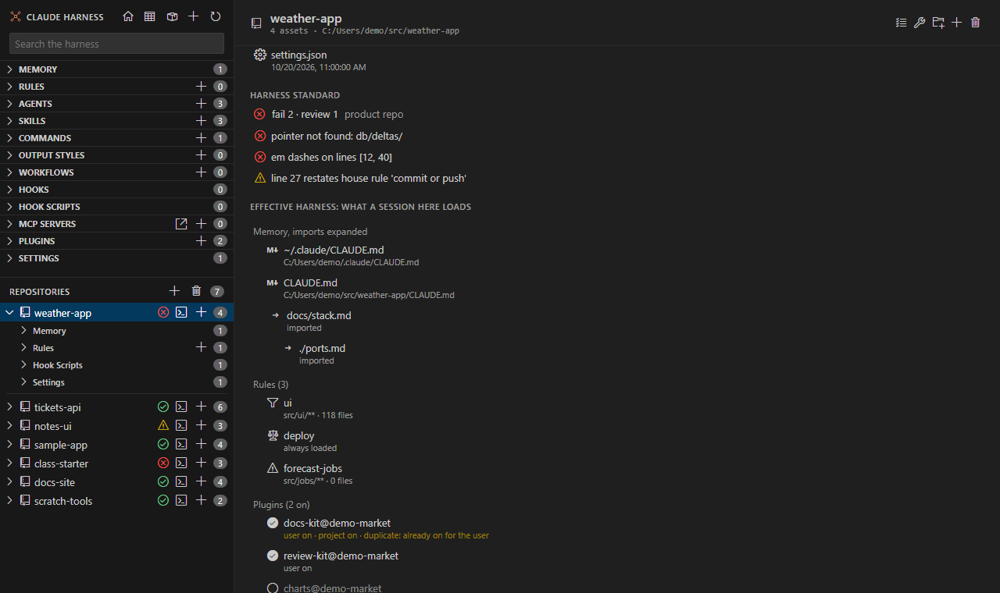

# Effective harness

<table width="100%" border="1" cellpadding="10" cellspacing="0">
<tr>
<td align="left"><a href="claude-md-lenses.md">← Back to CLAUDE.md lenses</a></td>
<td align="center"></td>
<td align="right"><a href="duplicates.md">→ Next: Duplicates</a></td>
</tr>
</table>

The **Effective harness** section on a repo page lists what a Claude Code session in that repo loads. It shows the memory files, the rules, the plugins and the hooks. Each row opens its file when it has one. The section sits below the [harness standard](harness-standard.md) findings.

## Memory and rules

| Part | What it lists |
| --- | --- |
| Memory | `~/.claude/CLAUDE.md`, the repo's `CLAUDE.md`, `CLAUDE.local.md` and `.claude/CLAUDE.md`. Lines that import a file with `@path` load that file too, up to five levels deep. Imports inside code are not followed. A missing file shows "not found". |
| Rules | The rules in `~/.claude/rules` and in the repo's `.claude/rules`. A rule with no paths shows "always loaded". A rule with `paths:` shows each glob with the number of files it matches. A `+` after the count means the count is capped. |

## Plugins and hooks

- **Plugins** lists the plugins in the user, project and local settings, with on or off for each scope. A plugin that a repo turns on, and that is already on for you, is marked **duplicate: already on for the user**.
- **Hooks** lists the hooks from the three settings files and from enabled plugins. Each row shows the event, the matcher, the command and where it comes from. A mod shows with the mod icon.

---

<table width="100%" border="1" cellpadding="10" cellspacing="0">
<tr>
<td align="left"><a href="claude-md-lenses.md">← Back to CLAUDE.md lenses</a></td>
<td align="center"><a href="#effective-harness">↑ Back to top</a></td>
<td align="right"><a href="duplicates.md">→ Next: Duplicates</a></td>
</tr>
</table>
