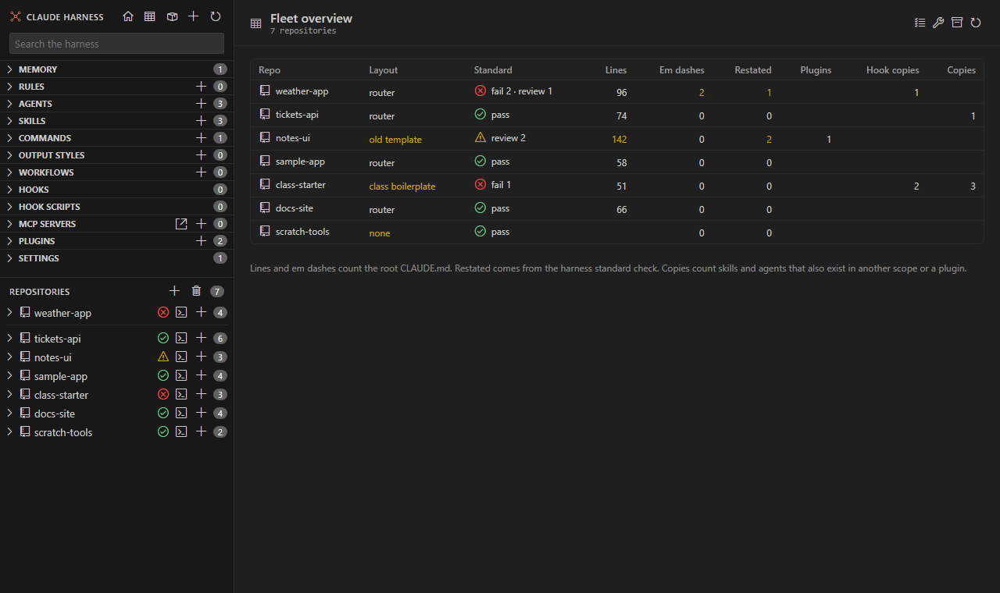

# Fleet overview

<table width="100%" border="1" cellpadding="10" cellspacing="0">
<tr>
<td align="left"><a href="bulk-edits.md">← Back to Bulk-edit guard</a></td>
<td align="center"></td>
<td align="right"><a href="init-product-repo.md">→ Next: Init product repo</a></td>
</tr>
</table>

The Fleet overview shows every repo in one table. Use it to compare layouts, check the harness standard and spot copies. Clicking a row opens that repo's page.

## Columns

| Column | Meaning |
| --- | --- |
| Repo | The repo name |
| Layout | `router`, `old template`, `class boilerplate`, `other` or `none`, from the root `CLAUDE.md` |
| Standard | The result of the [harness standard](harness-standard.md) check, with its badge |
| Lines | The line count of the root `CLAUDE.md`. Above 120 lines shows in yellow. |
| Em dashes | The em dashes in the root `CLAUDE.md` |
| Restated | The number of restated house rules from the check |
| Plugins | The plugins enabled in the repo's settings. The tooltip lists them. |
| Hook copies | Hook scripts that also exist in another scope or a plugin |
| Copies | Skills and agents that also exist in another scope or a plugin. See [Duplicates](duplicates.md). |

## Toolbar

| Button | What it does |
| --- | --- |
| Check every repo | Runs the harness standard check on all repos |
| Fix settings and hooks | Starts [Fix settings and hooks](fix-settings.md) for the repos you pick |
| Retire clean copies | Starts [Retire Clean Copies](duplicates.md#retire-clean-copies) |
| Reload | Reloads the table |

## Open the Fleet overview

- The table icon in the main window sidebar header.
- The table icon in the activity bar title bar, and on the **Repositories** node.
- **Claude Harness: Fleet Overview** in the command palette.

---

<table width="100%" border="1" cellpadding="10" cellspacing="0">
<tr>
<td align="left"><a href="bulk-edits.md">← Back to Bulk-edit guard</a></td>
<td align="center"><a href="#fleet-overview">↑ Back to top</a></td>
<td align="right"><a href="init-product-repo.md">→ Next: Init product repo</a></td>
</tr>
</table>
