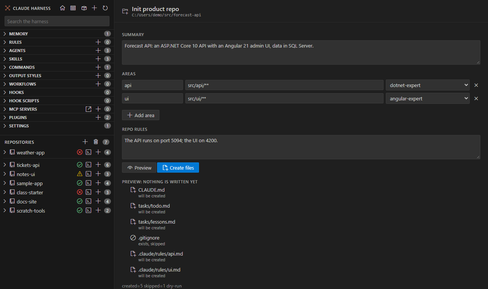

# Init product repo

<table width="100%" border="1" cellpadding="10" cellspacing="0">
<tr>
<td align="left"><a href="fleet-overview.md">← Back to Fleet overview</a></td>
<td align="center"></td>
<td align="right"><a href="rules-editor.md">→ Next: Rules editor</a></td>
</tr>
</table>

**Init Product Repo...** creates the harness files for a new product repo. You fill in a short form, preview the files, and then create the missing ones. Init never overwrites a file.

## Fill in the form

| Field | What to write |
| --- | --- |
| Summary | One to three sentences: what the product is and its stack |
| Areas | A name, the globs of its files, and an owner agent. Use commas or new lines between globs. |
| Repo rules | One repo-only hard rule per line |

The owner agent list shows the agents on disk. If an owner name is not on disk, the form reports it.

## Preview

**Preview** runs the script as a dry run. It lists each file as **will be created** or **exists, skipped**. Nothing is written.

## Create files

**Create files** is enabled only after a preview of the same form. It creates the missing files and skips the rest. If the folder already has a `CLAUDE.md`, the form says that init only creates missing files.

A created repo is added to the repo list, so it appears in the sidebar.

## Open the form

- The new-folder button on a repo page.
- **Init Product Repo...** in a repo's menu. It opens for that repo.
- **Claude Harness: Init Product Repo...** in the command palette. It asks for a folder first.

---

<table width="100%" border="1" cellpadding="10" cellspacing="0">
<tr>
<td align="left"><a href="fleet-overview.md">← Back to Fleet overview</a></td>
<td align="center"><a href="#init-product-repo">↑ Back to top</a></td>
<td align="right"><a href="rules-editor.md">→ Next: Rules editor</a></td>
</tr>
</table>
