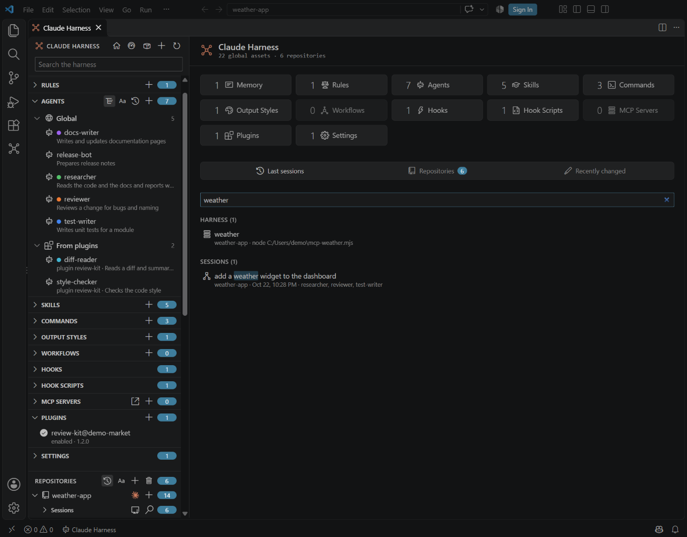
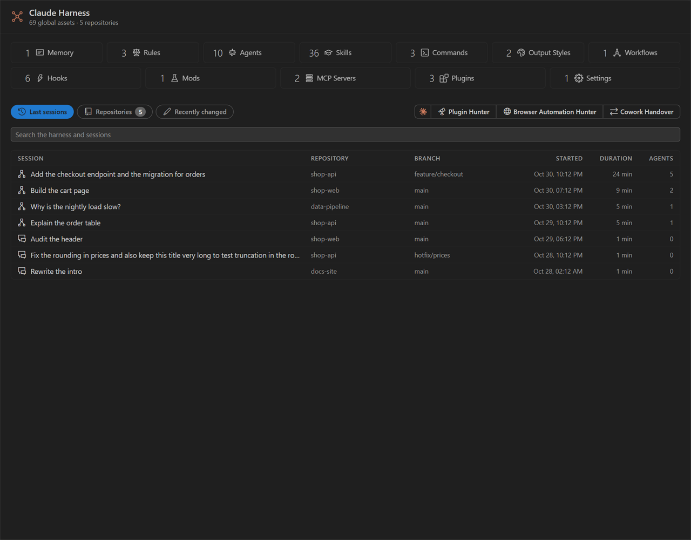
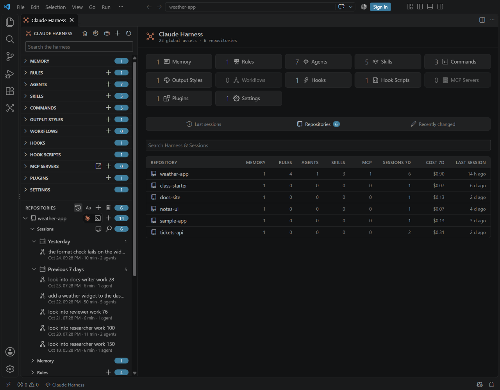

# Main window

<table width="100%" border="1" cellpadding="10" cellspacing="0">
<tr>
<td align="left"><a href="../README.md#features">← Back to Features</a></td>
<td align="center"></td>
<td align="right"><a href="harness-kinds.md">→ Next: Harness kinds</a></td>
</tr>
</table>

The main window shows your global harness and each repository in one place. The sidebar lists the sections, and the selected item opens on the right. Only one main window opens at a time. Running the command again brings the open window forward.

## Open the main window

| Method | Result |
| --- | --- |
| **Claude Harness** in the status bar (bottom bar) | Opens the main window |
| Claude Harness icon in the activity bar | Opens the main window, then puts back the side bar view you had open, or hides the side bar again when it was hidden |
| **Claude Harness: Open Claude Harness** in the command palette | Opens the main window |
| Ctrl+Alt+A | Opens the main window |

## Sidebar

The sidebar has a search box and five buttons in its header: first the pages, in the order of the sidebar from top to bottom, then the actions.

| Control | What it does |
| --- | --- |
| Overview (home icon) | Shows the overview page |
| Marketplace health (package icon) | Shows the marketplaces and their plugins. See [Marketplace health](marketplace-health.md). |
| GitHub Repo overview (GitHub icon) | Shows one table of every repo, with a search box. See [GitHub Repo overview](fleet-overview.md). |
| New (plus icon) | Creates an item. See [Editing](editing.md#create-rename-duplicate-and-delete). |
| Refresh | Reloads the harness and the MCP server list |

The global sections come in this order: **Memory**, **Rules**, **Settings**, **Output Styles**, then **Agents**, **Skills**, **Commands**, **Workflows**, **MCP Servers**, then **Hooks**, **Mods**, **Plugins** and **Marketplaces**. That is what every session loads, what Claude calls, what runs on its own, and where packaged parts come from. **Marketplaces** lists every marketplace Claude Code knows; a row opens the marketplace's page and the header opens Marketplace health. See [Marketplace page](marketplace-health.md#marketplace-page). The sections of a repo keep their own order.

The sidebar is a tree you can use from the keyboard. Tab moves into it, then Up and Down move between rows, Home and End jump to the first and last row, Right opens a section or moves into it, Left closes it or moves to its parent, and Enter opens the row. Space folds or unfolds a section. The row you open is scrolled into view, and Overview (the home icon) opens the overview with an empty search box.

The search box filters every section by name and description. The search boxes of the type pages and of the Sessions page are full width, with a clearer border.

Click a global section header (Agents, Skills, MCP Servers and so on) to open the same type page as its tile on the overview, and to fold or unfold the section. A repo's section header only folds. A repo's type page opens from its tile on the repo page and lists what lives in that repo only; the **Scope** filter widens it. What a plugin ships is a scope of its own, **Plugins**, so **Scope: Global** never lists a plugin's items. Some section headers also have toggle buttons that group the items (by where they live, by source or by marketplace) and sort them (by name, by last change, or by status for MCP servers).

An agent in the list shows a color swatch before its name when its frontmatter sets a `color`. An agent without that field shows none, and the colors that session views assign to it do not appear here.

A section header stays on one line. A section with more than three ways to list its items shows one **View** button that opens a small menu of them, instead of a button for each. Right-click a repo row for **Open Repo**, **Open Claude Here**, **New...**, **Reveal in File Explorer** and **Remove Repo...**. Cards that hover over the page, such as the card of a repo row, go away when you press a key, scroll, click or move off the panel.

Below the global sections, the **Repositories** group lists each repo. Click a repo to open its page. Its chevron expands its sections. When a repo is open, its sections start with a **Sessions** node, above **Memory**, with its count. Click the search icon to open the [Sessions page](sessions.md#sessions-page), and click the row to fold or unfold the sessions. Use the buttons on the group header to sort the repos by last used or A-Z, and to add or remove repos. See [Repositories](repositories.md).

A repo page has four tabs: **Overview**, with one tile for each section (in the same one-line style as the overview) and **Recently changed**, **Effective harness**, **Sessions** and **Models**. Models shows the last 7 days of tokens and cost for each account, for this repo, by model and by agent type; see [Last 7 days](sessions.md#last-7-days). The page header has a button to create an item in the repo. See [Repositories](repositories.md#repository-page) and [Effective harness](effective-harness.md). Provider features appear when a harness standard provider plugin is installed.

Right-clicking a row in the main window's tables and sidebar opens the same kind of menu: besides Open, Rename and Duplicate it can offer **Share...**, **Sync**, **Sync from Global...**, **Sync to Other Copies...** or **Sync Plugin from Its Marketplace...**, each only where it applies. Under each name, the sidebar row has a second line of at most three facts for its kind: when it changed, how often it was used and its size or state. Each fact has a hover card.

Actions that start Claude sit in a Claude group, a box led by the Claude mark with one button per action. On every bar of the main window, page headers and command bars alike, the Claude group is the last item, at the right end, also when the bar wraps. Buttons inside a table row or a card stay where they are.

## Overview

The overview shows the number of global assets and repositories. It has one tile for each global section, on one line: the icon, the label and the count beside them. A count of zero is dimmed. Click a tile to open that section's type page: its items, with a search box and filters.

Below the tiles, three tabs, and under them the search box. The tab you picked last is remembered. At the right end of the tabs row, the Claude group holds **Plugin Hunter** (telescope icon), which opens the [Plugin Hunter](plugins.md#plugin-hunter). While you search, the results replace the list of the open tab; clear the search to bring the list back.

- **Last sessions** (the default tab): the newest sessions across all repos, newest first: at least 10, and as many as fit the panel height, up to 100. Each row shows the title (the first prompt), the repository, the branch, the start, the duration, the number of agents and whether the session is live or headless. Click a row to open the session.
- **Repositories** (the tab shows the repo count): one row per repo, across the full width, in columns: its memory, rules, agents, skills and MCP counts, the sessions of the last 7 days, the cost of the last 7 days and the time since its last session. Click a row to open the repo. Below about 620 px wide only the three 7-day columns remain. For the cost and the plan limits behind them, see [Last 7 days](sessions.md#last-7-days).
- **Recently changed**: a one-line table of the most recently changed memory, rules, agents, skills, commands, output styles and workflows across all scopes, with the columns **Name**, **Type**, **Scope** and **Changed**. It shows at least 12 rows and as many as fit the panel height, up to 100. The **Type** column drops at narrow widths.

The search box, **Search the harness and sessions**, filters the harness items by name and description, and also matches sessions by prompt, agent, branch and date. The hits show in two groups in place of the tab's list: **Harness (n)**, then **Sessions (n)**, which holds the newest 25 matching sessions. Click a session to open it.

The type pages of agents, skills and commands have a **Used** column and two more filters. See [Used column on the type pages](sessions.md#used-column-on-the-type-pages).

---

<table width="100%" border="1" cellpadding="10" cellspacing="0">
<tr>
<td align="left"><a href="../README.md#features">← Back to Features</a></td>
<td align="center"><a href="#main-window">↑ Back to top</a></td>
<td align="right"><a href="harness-kinds.md">→ Next: Harness kinds</a></td>
</tr>
</table>
