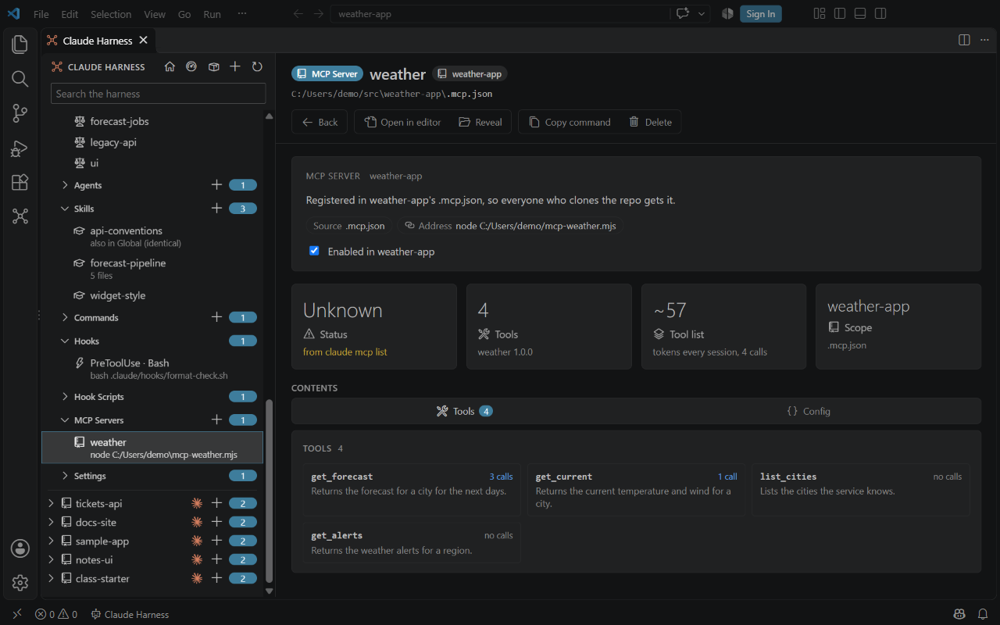
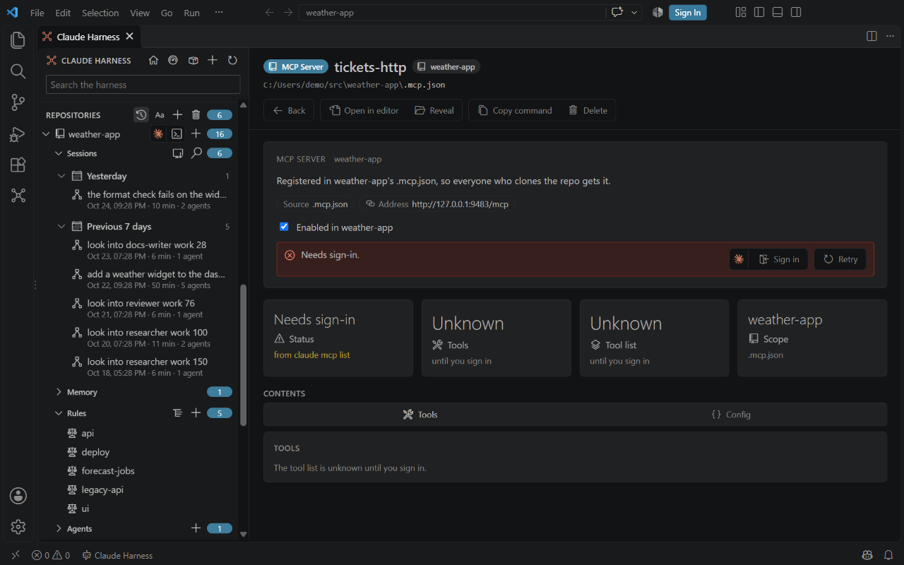

# MCP servers

<table width="100%" border="1" cellpadding="10" cellspacing="0">
<tr>
<td align="left"><a href="configure-tools.md">← Back to Configure Tools</a></td>
<td align="center"></td>
<td align="right"><a href="mcp-toggles.md">→ Next: MCP switches</a></td>
</tr>
</table>

The MCP Servers section lists the servers in the global harness and in each repo. Each server shows its source, its address and its status. Use [MCP switches](mcp-toggles.md) to turn a server on or off.

| Section | Description |
| --- | --- |
| [Where the servers come from](#where-the-servers-come-from) | The five sources and the list they appear in |
| [Group and sort the list](#group-and-sort-the-list) | Group by where a server lives or by source, sort by name or status |
| [Server details](#server-details) | The facts and config shown for a server |
| [Tools](#tools) | Tool names read from the server, the messages shown when a server does not answer, and sign-in |
| [Delete a server](#delete-a-server) | Remove a server's entry from its config file |
| [Add a server](#add-a-server) | The plus button and the command |
| [Copy as a command](#copy-as-a-command) | The `claude mcp add` line for a server |
| [Add a connector](#add-a-connector) | The button that opens claude.ai connectors |

## Where the servers come from

| Source | Read from | Shown in |
| --- | --- | --- |
| Your config | `mcpServers` in `~/.claude.json` | Global |
| Local to this repo | The repo's entry in `~/.claude.json` | That repo |
| Repo `.mcp.json` | `mcpServers` in the repo's `.mcp.json` | That repo |
| claude.ai connector | `claude mcp list`, for names that start with `claude.ai ` | Global |
| Plugin | `claude mcp list`, for names that start with `plugin:` | Global |

The global list also includes servers that `claude mcp list` reports but that are not in `~/.claude.json`. Their source follows the name: a `claude.ai ` prefix means connector, a `plugin:` prefix means plugin, and any other name counts as your config.

The status comes from `claude mcp list`. Claude Harness runs that command when it starts and when you click **Refresh**.

## Group and sort the list

The four toggle buttons in the MCP Servers header group the list or sort it. Claude Harness remembers your choice. The list starts grouped by where each server lives.

| Option | Order |
| --- | --- |
| Group by where it lives (default) | Global first, then claude.ai connectors, then plugins, then each repo in the sidebar's order, the open workspace first. |
| Group by source | Registered manually, claude.ai connectors, then From plugins. |
| Sort by name | Alphabetical. The `claude.ai ` prefix and the `plugin:` prefix are not counted. |
| Sort by status | Connected first, then servers that need sign-in, then other statuses, then servers that are not configured, then servers that are off. Each group is sorted by name. |

In a grouped list, the servers of each group follow their source: your config, Local to this repo, Repo `.mcp.json`, claude.ai connector, then Plugin. Servers of the same plugin stay together, then they are sorted by name.

## Server details

The MCP Servers page is a table with the columns Name, Description, Source (`global`, `repo`, `marketplace` or `claude.ai`, with the config file or plugin in the hover card), Status (`Connected`, `Failed`, `Sign-in`, `Unconfigured` or `Off`, with the full text in the hover card) and Changed in days. A server that is also registered elsewhere gets a Duplicate of column.

Click a server to open its detail view. It shows:

- Its source, its plugin when it comes from one, its name in Claude, its address and its status.
- The plugin's description, for plugin servers.
- The switch for the server. See [MCP switches](mcp-toggles.md).
- A **Config** excerpt of the server's entry, for servers defined in a config file.

## Tools

The detail view asks the server for its tools and lists their names under **Tools**, with the count. The **Config** block stays below the list. The **Tool list** tile reads, for example, `1,240 tokens every session, 18 calls`: the tokens that the tool names and descriptions add to every session, and how often the server's tools were called in your recorded sessions. Each tool card has a calls chip, such as `4 calls`, or `no calls` when the tool was never called. The counts come from the usage index that the first open of a Used in tab builds; see [Used in](sessions.md#used-in). Until then the tile shows only the tokens. The panel asks each server once per panel session. **Retry** asks again.

### Local commands

For a server that runs as a local command, Claude Harness starts the command briefly to read its tools:

- It runs from the repo folder for a repo server, or from your home folder for a global server.
- It runs once per panel session. It stops as soon as the tools are read.
- It waits up to 60 seconds for an answer.
- `${VAR}` and `${VAR:-default}` in `command`, `args` and `env` are expanded. An unset `${VAR}` becomes an empty string, and `${VAR:-default}` uses the default when the variable is not set.

### HTTP servers

For a server with an `http://` or `https://` address, the detail view connects to the address and reads its tools. Headers from the server's config entry are sent with these requests. Opening the detail view therefore makes a request to that address.

When the config sets no `Authorization` header, the panel sends the sign-in token that Claude Code stored for that server URL. The token comes from the `mcpOAuth` entries in `.credentials.json` in the global harness folder (`~/.claude` unless you set `claudeHarness.root`). The panel matches the URL and prefers a token for the same server name that has not expired.

### Messages

| Message | Meaning |
| --- | --- |
| Asking the server for its tools... | The request is running |
| The server did not answer within 10 seconds. | The address did not answer in time |
| The server did not answer within 60 seconds. | The local command did not list its tools in time |
| Needs sign-in. | The server answered 401 or 403. Only HTTP servers get this message. |
| The server answered 404 Not Found. | The address answered with another error status |
| Could not start it: ... | The local command could not be started |
| It exited with code N before listing its tools. | The local command stopped early. The last lines of its error output follow the message. |
| Its config names neither a URL nor a command. | The entry has no address and no command |

Every error message comes with a **Retry** button.

### Sign in

The Status of a server is one fact in the info card of its page: an icon, a word such as `Connected` or `Failed`, and the server's own message, with the full text from `claude mcp list` in the hover card. When a server answers that it needs sign-in, the line reads **Needs sign-in**, with **Sign in** and **Retry** at its right end. Any other error shows the same line in red with **Retry** only. A server that is switched off shows a notice instead, and no sign-in: switch it on first.

| Button | What it does |
| --- | --- |
| Sign in | For a claude.ai connector, opens the connectors page on claude.ai in your browser. For any other server, opens a VS Code terminal in the repo folder or your home folder and runs `claude "/mcp"`. Pick the server there and sign in. |
| Retry | Asks the server for its tools again. The button reads **Retrying...** and stays disabled until the answer comes, and the box then starts with **Checked again:** so you can tell the check ran. |

## Delete a server

The command bar of the server page has a **Delete** button for a server that has an entry in a config file: `.mcp.json` in a repo, or `~/.claude.json` for your own config and for a repo's entry there. Claude Harness asks you to confirm with a card under the button (a VS Code dialog when you start it from the sidebar tree), then removes that entry from the file. Removing the entry can reformat the entries next to it in that file.

claude.ai connectors and plugin servers have no entry in a file, so they have no trash button.

## Add a server

Click the plus button on the **MCP Servers** header, or run **Claude Harness: Add MCP Server...**. Pick the scope, type a name, then enter a command line or a URL. See [Commands](commands.md#add-mcp-server).

## Copy as a command

The **Copy command** button in the server page command bar copies a `claude mcp add` line for the server to the clipboard. See [Commands](commands.md#copy-as-claude-mcp-add-command).

## Share and sync

**Share...** in the right-click menu of a server that has an entry in a file saves it as a `.json` file in your Downloads folder, and **Import MCP Server...** merges such a file into the settings of the scope you pick. See [Share and Import](commands.md#share-and-import).

When the same server name is configured differently in several files, **Sync to Other Copies...** in its right-click menu and on its page asks which configuration to keep, then replaces the entry in each other file after a backup. When all copies are the same it says there is nothing to sync.

## Add a connector

The global MCP Servers header has a link icon with the tooltip **Add a connector on claude.ai**. Click it to open the connectors page on claude.ai in your browser.

---

<table width="100%" border="1" cellpadding="10" cellspacing="0">
<tr>
<td align="left"><a href="configure-tools.md">← Back to Configure Tools</a></td>
<td align="center"><a href="#mcp-servers">↑ Back to top</a></td>
<td align="right"><a href="mcp-toggles.md">→ Next: MCP switches</a></td>
</tr>
</table>
