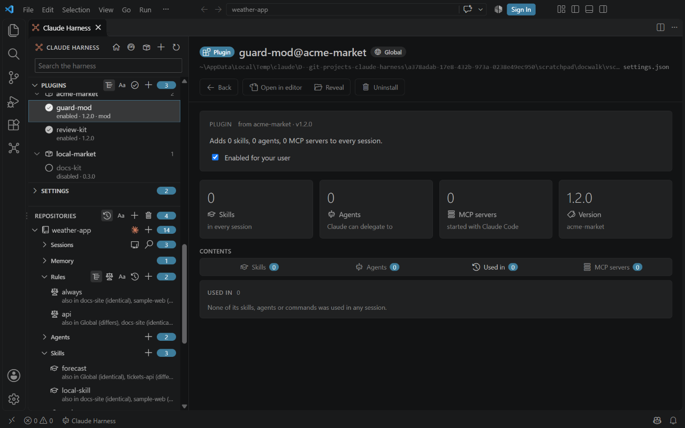

# Plugins

<table width="100%" border="1" cellpadding="10" cellspacing="0">
<tr>
<td align="left"><a href="mcp-toggles.md">← Back to MCP switches</a></td>
<td align="center"></td>
<td align="right"><a href="settings.md">→ Next: Settings</a></td>
</tr>
</table>

The Plugins section lists the plugins in the global harness and in each repo. You can enable or disable a plugin without opening a settings file.

## What is listed

- The global Plugins section lists the plugins in `enabledPlugins` in `~/.claude/settings.json`, and the plugins installed for your user in `plugins/installed_plugins.json`.
- A repo lists the plugins in `enabledPlugins` in its own `.claude/settings.json`.
- Each row shows whether the plugin is enabled or disabled, and its version when it is known.

## Turn a plugin on or off

| Where | How |
| --- | --- |
| Detail view | Tick or clear **Enabled**. The change is written at once. |
| Activity bar view | Click the circle button on the plugin's row. Its tooltip is **Enable / Disable Plugin**. |

## What it changes

The switch sets the plugin's key under `enabledPlugins` in the `settings.json` of that folder, to `true` or `false`. It adds the key when it is missing. No other key changes.

## Install and uninstall

Click the plus button on the **Plugins** header, or run **Claude Harness: Install Plugin...**, to install a plugin from your marketplaces. The trash button on a plugin page, the tree's right-click menu and **Claude Harness: Uninstall Plugin...** uninstall it. Both run the `claude plugin` command in a terminal. See [Commands](commands.md#install-and-uninstall-plugins).

To see which installed plugins are behind their marketplace source, open [Marketplace health](marketplace-health.md). A plugin whose source is ahead of the installed copy is flagged there. The same page renames a directory marketplace and re-registers its plugins.

## Mods

A plugin is a mod when its hooks file declares a `modules` array. The hooks file is `hooks/hooks.json`, or the path that the plugin's `.claude-plugin/plugin.json` sets in its `hooks` key. Claude Harness reads the plugin's files from the global harness folder, for repo plugins too.

A mod gets ` · mod` after its description, for example `enabled · 0.2.0 · mod`. The mark shows in the plugin lists and on the plugin page.

---

<table width="100%" border="1" cellpadding="10" cellspacing="0">
<tr>
<td align="left"><a href="mcp-toggles.md">← Back to MCP switches</a></td>
<td align="center"><a href="#plugins">↑ Back to top</a></td>
<td align="right"><a href="settings.md">→ Next: Settings</a></td>
</tr>
</table>
