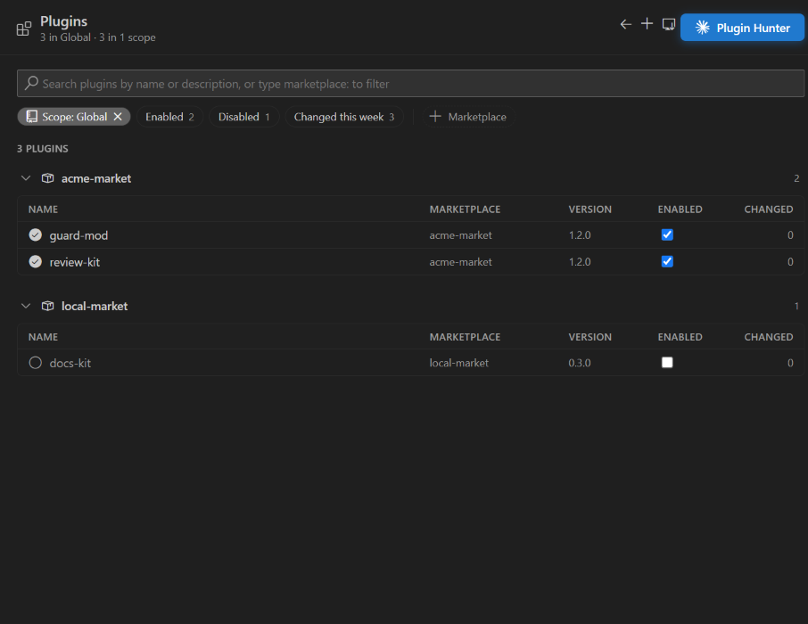
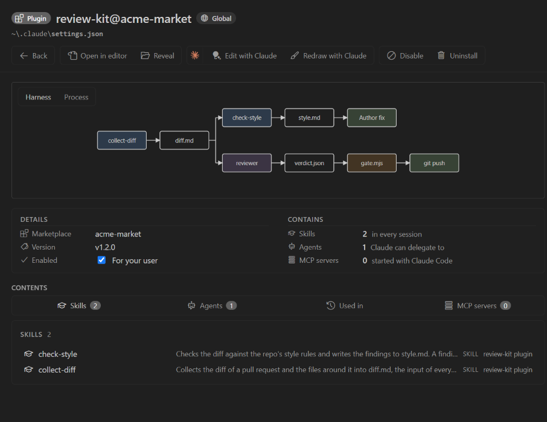
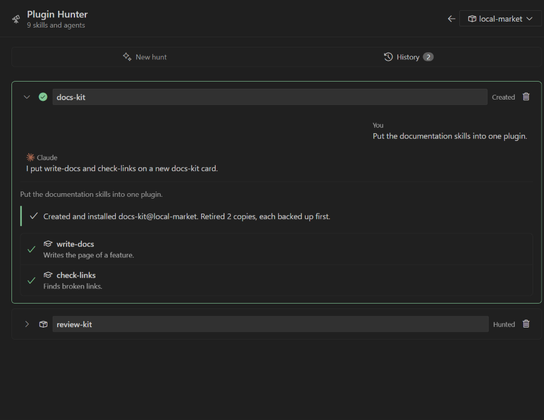
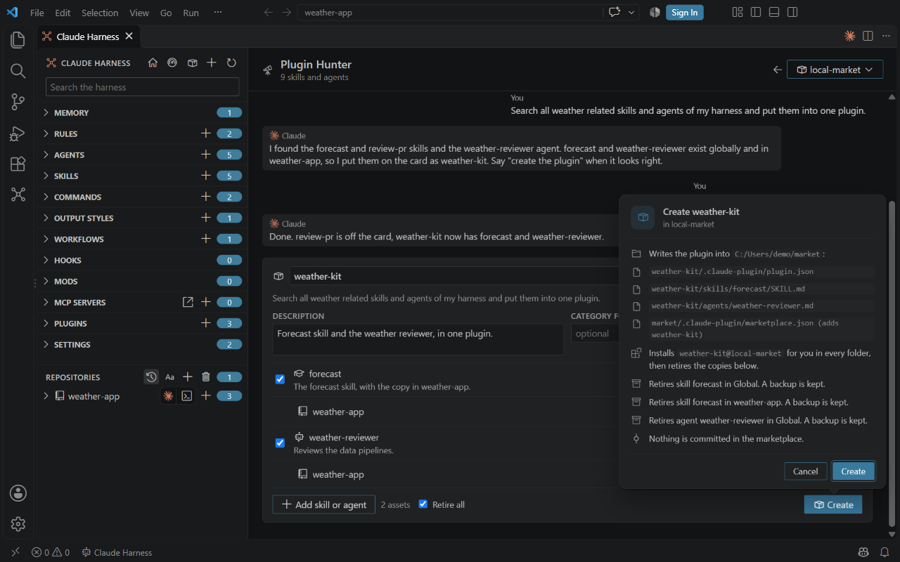
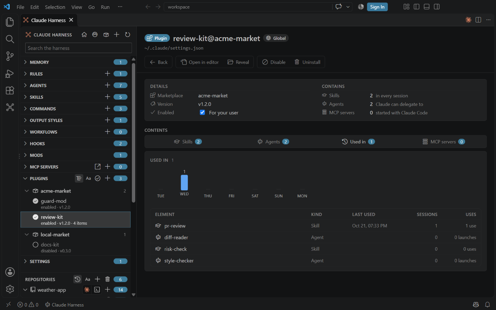

# Plugins

<table width="100%" border="1" cellpadding="10" cellspacing="0">
<tr>
<td align="left"><a href="mcp-toggles.md">← Back to MCP switches</a></td>
<td align="center"></td>
<td align="right"><a href="skill-sources.md">→ Next: Skill sources</a></td>
</tr>
</table>

The Plugins section lists the plugins in the global harness and in each repo. You can enable or disable a plugin without opening a settings file.

## What is listed

- The global Plugins section lists the plugins in `enabledPlugins` in `~/.claude/settings.json`, and the plugins installed for your user in `plugins/installed_plugins.json`.
- A repo lists the plugins in `enabledPlugins` in its own `.claude/settings.json`.
- The table has the columns Marketplace, Version and Enabled, with Changed and Scope where they apply. The Enabled column is a switch.

## Turn a plugin on or off

| Where | How |
| --- | --- |
| Plugins page | Use the switch in the **Enabled** column of the plugin's row. It enables or disables the plugin in the scope of that row, and clicking it does not open the plugin. |
| Detail view | Tick or clear the checkbox under the description, **Enabled for your user** for a global plugin. The change is written at once. |

## What it changes

The switch sets the plugin's key under `enabledPlugins` in the `settings.json` of that folder, to `true` or `false`. It adds the key when it is missing. No other key changes.

## Agents in the global list

Each agent of a plugin enabled in `~/.claude/settings.json` also appears in the global **Agents** list, in the **From plugins** group under the **Global** group. The skills of an enabled plugin appear the same way in the **From plugins** group of the **Skills** list. Each group is sorted by name. These copies are read-only. Each description starts with `plugin <name>`, for example `plugin review-kit · Reviews a pull request`. Plugins enabled only in a repo's settings do not add agents to the global list.

## Install and uninstall

Click the plus button on the **Plugins** header, or run **Claude Harness: Install Plugin...**, to install a plugin from your marketplaces. The **Uninstall** button on a plugin page and **Claude Harness: Uninstall Plugin...** uninstall it. From the plugin page a card under the button asks first; from the palette a VS Code dialog does. Both run the `claude plugin` command in a terminal. See [Commands](commands.md#install-and-uninstall-plugins).

To see which installed plugins are behind their marketplace source, open [Marketplace health](marketplace-health.md). A plugin whose source is ahead of the installed copy has a **Sync plugin** button in the Sync column there, which refreshes the marketplace and updates the plugin, and **Sync all** in the column's header syncs every plugin that is ahead after one card. The right-click menu of a plugin has **Sync Plugin from Its Marketplace...** for one plugin. The same page renames a directory marketplace and re-registers its plugins.

The Plugins page lists the plugins in one group per marketplace. The name in a group's heading is a link: it opens that [marketplace's page](marketplace-health.md#marketplace-page), whose **Back** button returns to the Plugins page. A click elsewhere on the heading folds or unfolds the group.

## Drawing a plugin

A plugin page shows a drawing above its details once Claude has drawn it. Press **Draw with Claude** in the Claude group of the command bar; it reads **Redraw with Claude** afterwards. A card asks first, because the run counts against your plan. The drawing is made from the plugin's manifest and its skills, agents, commands, hooks and servers, and it is dropped when those change. Hover the drawing to see it enlarged.

A toggle in the top left corner of the drawing switches the perspective:

- **Harness** shows how the plugin's skills, agents, scripts and hooks connect to a Claude session.
- **Process** shows the plugin as a process. The stages follow in the order they run, left to right across the page width. Each card names the stage, says in a line what it does, where it runs and which condition ends it, and shows the file it writes. A Shared ledger column lists those files, with a solid arrow from the stage that writes one and a dashed arrow to the stage that reads it. An arrow in the accent colour leads back to the stage a fault came from, and a stage that repeats carries a loop mark. Under the stages, one line per mod (hook module) says what it does, read from the module's code.

Each perspective has its own drawing. The button draws the one that is shown, and drawing one leaves the other as it was. On the plugin page, the **Skills** and **Agents** tabs show what each item does between its name and its tags; the full text is in the hover.

## Plugin Hunter

The **Plugin Hunter** button opens a page that builds a new plugin from the skills and agents you already have. It has a telescope icon and sits in the Claude group, because the hunt is Claude's work and counts against your plan: last, at the right end of the Plugins page header, and at the right end of the overview's tabs row. Claude proposes the plugin; nothing is written until you press **Create** and agree.

The page has two tabs. **New hunt** is split in half. The left half is a chat like any other: the conversation in order with the newest message at the bottom, and the message box pinned under it. The right half holds the findings and selections: the proposed card with the skills and agents Claude found, the picker that adds or drops them, and Create. Each half scrolls on its own, and on a narrow panel the halves stack. **History** holds every other card, see below.

- **Marketplace.** The picker in the header chooses where the plugin is created. Only a directory marketplace is selectable, that is a folder on your disk with a `.claude-plugin/marketplace.json`. GitHub, git and URL marketplaces are listed but disabled, because Claude Code overwrites its copies of them when it updates them. The page starts on the marketplace you used last, or else on your own marketplace with the most installed plugins. Your pick is remembered.
- **Conversation.** Talk to Claude in the box under the conversation and press **Hunt** or Enter (Shift+Enter starts a new line), for example: search all angular related harness elements. Then: create the plugin. Or: take angular-pwa-swa out. **Go** sends the same box as a change to the ticked elements of the card, for example `rename docker-images to hetzner-docker`; it needs text and a ticked element. Claude answers in the conversation in at most two short sentences, and a search that finds elements puts them on a plugin card for you to edit. The first message of a conversation asks first, because it sends your message, the conversation so far and the name, description and location of every skill and agent of yours, in Global and in every repo Claude Harness knows, but no file contents. The count in that card is the count in the page header. While Claude works, the box is emptied, your message shows once in the conversation, and the waiting reply counts the time so far. **New plugin** and **Start over** wait until the answer is there. **Start over**, at the top of the chat, clears the conversation, including the chats kept in History, and keeps the cards. The conversation follows the newest message while you are at the bottom of it.
- **Cards.** Each proposal is a card with the plugin name, the line you asked and its skills and agents. The bar under the title holds **Add skill or agent**, the asset count, **Retire all** and **Create**. Changes to the ticked elements go through the chat with **Go**: Claude answers in the conversation and the card updates. A rename shows on the element as an **as <new name>** tag, and Create writes the element under the new name; two elements that would end up with the same name stop Create. Every element and every copy sits in the same columns: tick, name, copy state, Retire, Merge or Compare, remove. Clear the box in front of an element to leave it out, or press the close button to take it off the card. The description and the category folder (needed only when the marketplace keeps its plugins in category folders) are not shown on the card; Create uses the values Claude set, and when the marketplace needs a category and the card has none, the hint on Create says to ask Claude for one.
- **Copies.** An element that exists in more than one place lists each copy under it. Each copy has a **Retire** tick, and its hover says whether it is the global or the repo copy: a ticked copy is backed up and removed after the plugin is installed. The ticks start off. **Retire all**, in the bar, ticks every listed copy of the ticked elements at once, and clearing it clears them all; it shows a dash while only some are ticked, and follows the single ticks. An element that is not ticked has its Retire boxes and those of its copies cleared and disabled, and unticking an element clears them. Two repos with the same folder name show the folder they sit in, for example **in git-classes**. A repo copy of a skill that differs from the global one is marked **differs** and has a **Merge** button, which opens [Consolidate](duplicates.md#consolidate) for it. A differing repo copy of an agent has a **Compare** button, which opens the two files side by side in the editor; agents are not merged here.
- **New plugin.** Starts an empty card without asking Claude. **Add skill or agent** opens a picker with a search over your skills and agents, skills first.
- **Create.** Press **Create** on a card, and a card under the button lists every file that is written, the install, and every copy that is retired. After you agree, the extension writes the plugin and its entry in the marketplace, installs it for you in every folder, and retires the ticked copies. Each retired copy is backed up to `~/.claude/repo-sync-backups` first. Nothing is committed in the marketplace. The card is then marked **Created**, and it keeps listing every element that went into the plugin, including those whose copies were retired. A created card moves to the History tab, which opens on it.
- **History.** Every card except the one you are working on, newest first, each with the chat turns that made it. An item is collapsed to its header, the plugin name with **Created** or **Hunted**; a click on the header or its chevron opens it and closes it again, card and chat together. A chat saved before this version is shown with the newest card made at or before it.

## Used in

A plugin page has a **Used in** tab. It lists each skill, agent and command of the plugin with its last use, its sessions and its uses, most used first, above a 7-day strip of the days it was used. The plugin's **Skills** and **Agents** tabs show each element's use count, or "never used", once the index is built. See [Other Used in tabs](sessions.md#other-used-in-tabs).

## Mods

A plugin is a mod when its hooks file declares a `modules` array. The hooks file is `hooks/hooks.json`, or the path that the plugin's `.claude-plugin/plugin.json` sets in its `hooks` key. Claude Harness reads the plugin's files from the global harness folder, for repo plugins too.

A mod gets ` · mod` after its description, for example `enabled · 0.2.0 · mod`. The mark shows in the plugin lists and on the plugin page. A mod can also log its events for the session views: see [Mod events](sessions.md#mod-events).

The **Mods** section in the sidebar lists the plugins that are mods, the same entries as the Plugins list.

---

<table width="100%" border="1" cellpadding="10" cellspacing="0">
<tr>
<td align="left"><a href="mcp-toggles.md">← Back to MCP switches</a></td>
<td align="center"><a href="#plugins">↑ Back to top</a></td>
<td align="right"><a href="skill-sources.md">→ Next: Skill sources</a></td>
</tr>
</table>
