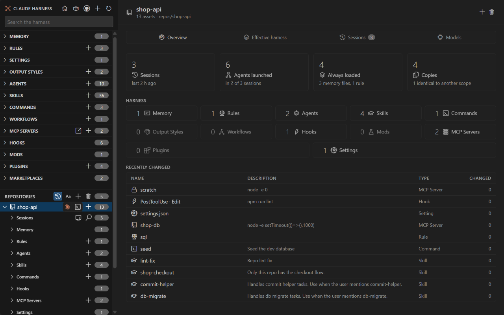

# Repositories

<table width="100%" border="1" cellpadding="10" cellspacing="0">
<tr>
<td align="left"><a href="editing.md">← Back to Editing</a></td>
<td align="center"></td>
<td align="right"><a href="harness-standard.md">→ Next: Harness standard</a></td>
</tr>
</table>

A repository appears under **Repositories** in the sidebar and in the activity bar. Its harness is read from its own `.claude` folder and its `CLAUDE.md` files, with the same kinds as the global harness. Click a repo to open its page.

| Section | Description |
| --- | --- |
| [Where repos come from](#where-repos-come-from) | The three sources and the order of the list |
| [Repository page](#repository-page) | The tiles, the sections and the buttons on a repo page |
| [Activity bar node](#activity-bar-node) | The Repositories node, its check badges and its buttons |
| [Add a repo](#add-a-repo) | Adds repo folders |
| [Remove a repo](#remove-a-repo) | Hides repos or added folders |

## Where repos come from

A folder counts as a repo when it has a `.claude` folder or a `CLAUDE.md` file. Claude Harness finds repos in three places:

| Source | Notes |
| --- | --- |
| Projects in `~/.claude.json` | The projects Claude Code knows about. Folders in the temp folder are skipped. Your home folder is never listed. |
| Open workspace folders | Each folder open in the VS Code window that has a `.claude` folder or a `CLAUDE.md` file. |
| Folders added with Add Repo | A repo folder, or a parent folder. A parent folder also checks its direct subfolders, except hidden folders, `node_modules`, `.git`, `__pycache__` and `.venv`. |

A subfolder that you create later under an added parent folder appears after you click **Refresh** or reload the window.

Repos that are open as workspace folders are listed first under **Repositories**. The other repos follow in alphabetical order by folder name. When both kinds are present, a thin line separates them.

## Repository page

The repo page shows the repo name, its path and its asset count. It has these parts:

- One tile for each section, with its count. Click a tile to open the first item in that section.
- **Recently changed**, with the 12 most recently changed items in the repo.
- **Harness standard**, with the findings of the check. See [Harness standard](harness-standard.md).
- **Effective harness**, with what a session in the repo loads. See [Effective harness](effective-harness.md).
- Header buttons: check the repo, fix its settings and hooks, init a product repo, and **New in** the repo name (plus icon) to create an item in this repo. See [Editing](editing.md#create-rename-duplicate-and-delete) and [Init product repo](init-product-repo.md).
- The trash button removes this repo from the harness. Nothing is deleted on disk.

The terminal icon on a repo row in the sidebar opens a terminal in that repo running `claude`. See [Commands](commands.md#open-claude-here).

## Activity bar node

The activity bar tree has a **Repositories** node below the global sections. Its count is the number of repos. Expand it to list the repos, and each repo shows its check badge and a short result, such as `fail 2 · review 1`. Click a repo to open its page.

The activity bar title bar has a [Fleet overview](fleet-overview.md) button. The **Repositories** node has two inline buttons: a check button that runs the harness standard check on every repo, and a table button that opens the Fleet overview. Its right-click menu has **Fix Settings and Hooks...**, **Retire Clean Copies...** and **Marketplace Health**. A repo row's menu has **Init Product Repo...** and **Open Repo**. The check runs when you expand the node. See [Harness standard](harness-standard.md#badges) for what each badge means.

## Add a repo

1. Run **Claude Harness: Add Repo...** from the command palette, or click the add button on the **Repositories** header in the sidebar.
2. Select one or more folders. Pick a repo folder, or a parent folder that holds several repos.
3. Claude Harness shows how many repos it added. If none of the folders has a `.claude` folder or a `CLAUDE.md` file, it says so.

Added folders are saved in the `claudeHarness.repoFolders` setting. Adding a repo, or its parent folder, again also shows a repo that you removed before. See [Settings](settings.md).

## Remove a repo

Remove a repo in one of two ways:

- Click the trash button on the repo page.
- Run **Claude Harness: Remove Repo...** from the command palette. The picker has two groups:

| Group | What removing does |
| --- | --- |
| Added folders | Removes the folder from `claudeHarness.repoFolders`. Removing a parent folder also removes all of its repos. |
| Repositories | Hides the repo through `claudeHarness.removedRepos`. This works for repos from `~/.claude.json`, open workspace folders and parent folders. |

Claude Harness reports how many repos it removed. Nothing is deleted on disk.

---

<table width="100%" border="1" cellpadding="10" cellspacing="0">
<tr>
<td align="left"><a href="editing.md">← Back to Editing</a></td>
<td align="center"><a href="#repositories">↑ Back to top</a></td>
<td align="right"><a href="configure-tools.md">→ Next: Configure Tools</a></td>
</tr>
</table>
