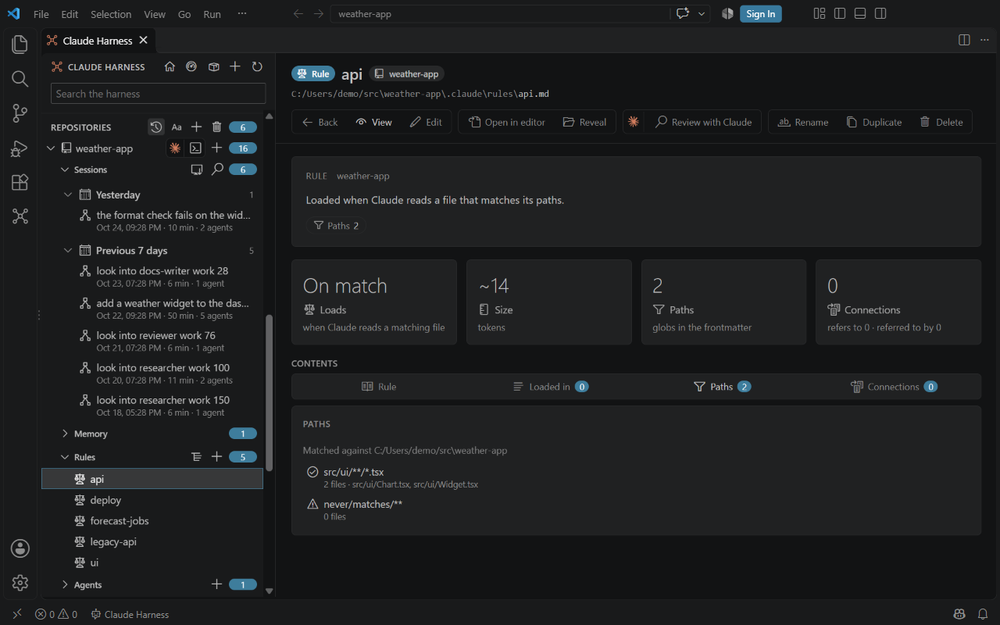

# Rules editor

<table width="100%" border="1" cellpadding="10" cellspacing="0">
<tr>
<td align="left"><a href="fleet-overview.md">← Back to Fleet overview</a></td>
<td align="center"></td>
<td align="right"><a href="marketplace-health.md">→ Next: Marketplace health</a></td>
</tr>
</table>

A rules file that is open in the main window shows which files its paths match. The paths match files in the repo that holds the rule.

## Paths

The **Paths** section lists each glob in the rule's `paths:` field:

| Row | Meaning |
| --- | --- |
| Check icon, with a count | The glob matches files. The count is followed by a few sample paths. |
| Warning icon, with 0 files | The glob matches nothing. Check the spelling of the glob. |

A rule with no paths shows "No paths: the rule loads in every session."

The section starts with a **Matched against** line that names the repo folder the globs are matched in. With a harness standard provider installed, it also ends with a row for the owner agent named in the rule, marked as found on disk or not.

Provider features appear when a harness standard provider plugin is installed.

---

<table width="100%" border="1" cellpadding="10" cellspacing="0">
<tr>
<td align="left"><a href="fleet-overview.md">← Back to Fleet overview</a></td>
<td align="center"><a href="#rules-editor">↑ Back to top</a></td>
<td align="right"><a href="marketplace-health.md">→ Next: Marketplace health</a></td>
</tr>
</table>
