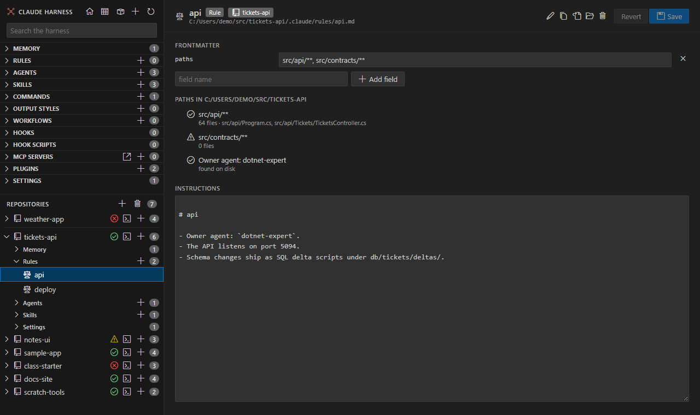

# Rules editor

<table width="100%" border="1" cellpadding="10" cellspacing="0">
<tr>
<td align="left"><a href="init-product-repo.md">← Back to Init product repo</a></td>
<td align="center"></td>
<td align="right"><a href="marketplace-health.md">→ Next: Marketplace health</a></td>
</tr>
</table>

A rules file that is open in the main window shows which files its paths match, and whether its owner agent exists. The paths match files in the repo that holds the rule.

## Paths

The **Paths** section lists each glob in the rule's `paths:` field:

| Row | Meaning |
| --- | --- |
| Check icon, with a count | The glob matches files. The count is followed by a few sample paths. |
| Warning icon, with 0 files | The glob matches nothing. Check the spelling of the glob. |

A rule with no paths shows "No paths: the rule loads in every session."

## Owner agent

A rule can name the agent that owns it with a line in its body, such as ``- Owner agent: `dotnet-expert`.``. The editor checks that the agent exists on disk:

- **found on disk** when an agent with that name exists.
- **no agent with this name on disk** when it does not.

A rule with no such line shows "No Owner agent line".

---

<table width="100%" border="1" cellpadding="10" cellspacing="0">
<tr>
<td align="left"><a href="init-product-repo.md">← Back to Init product repo</a></td>
<td align="center"><a href="#rules-editor">↑ Back to top</a></td>
<td align="right"><a href="marketplace-health.md">→ Next: Marketplace health</a></td>
</tr>
</table>
