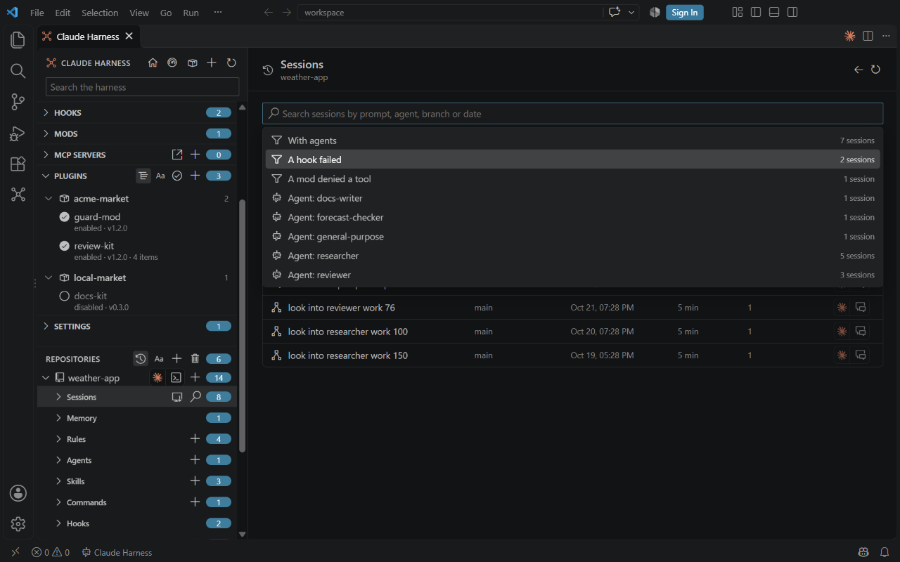
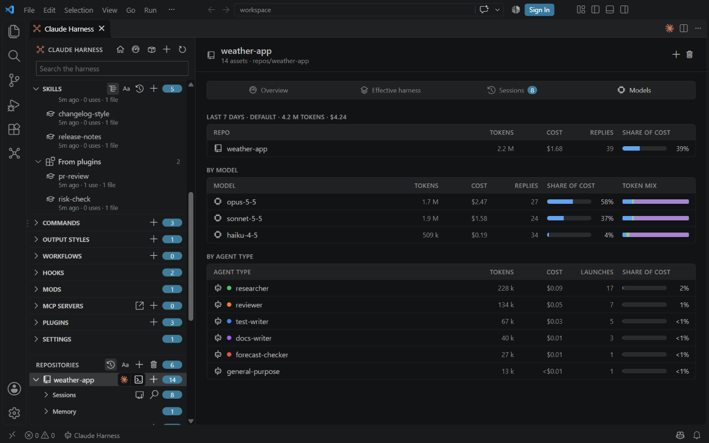
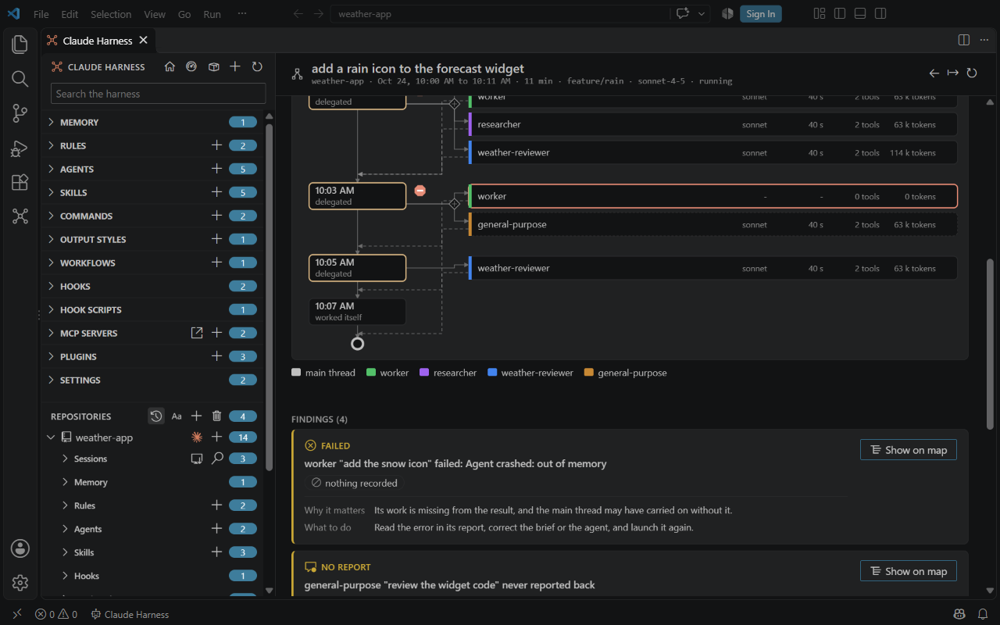
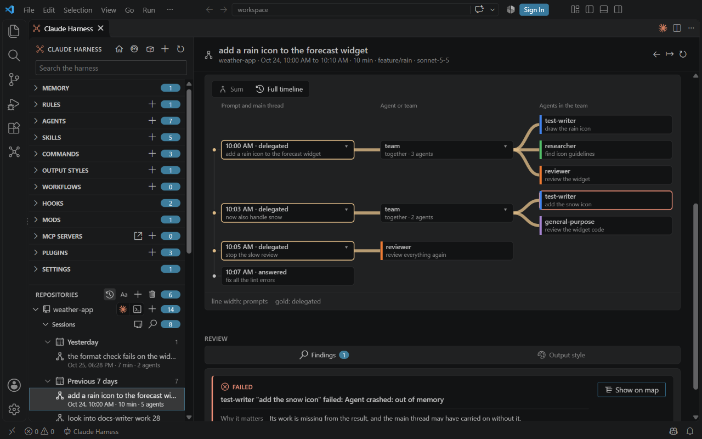
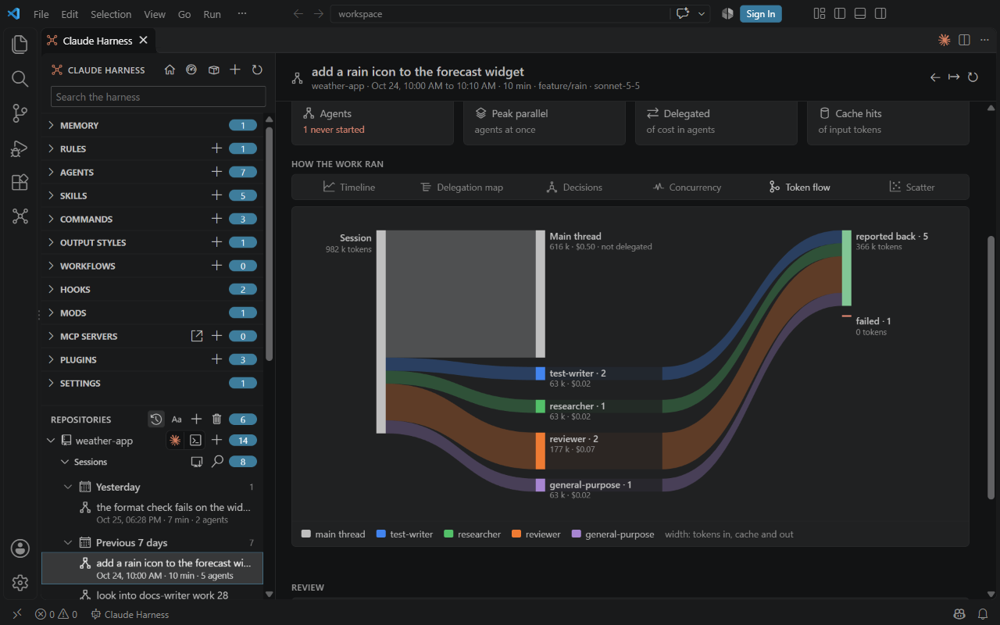
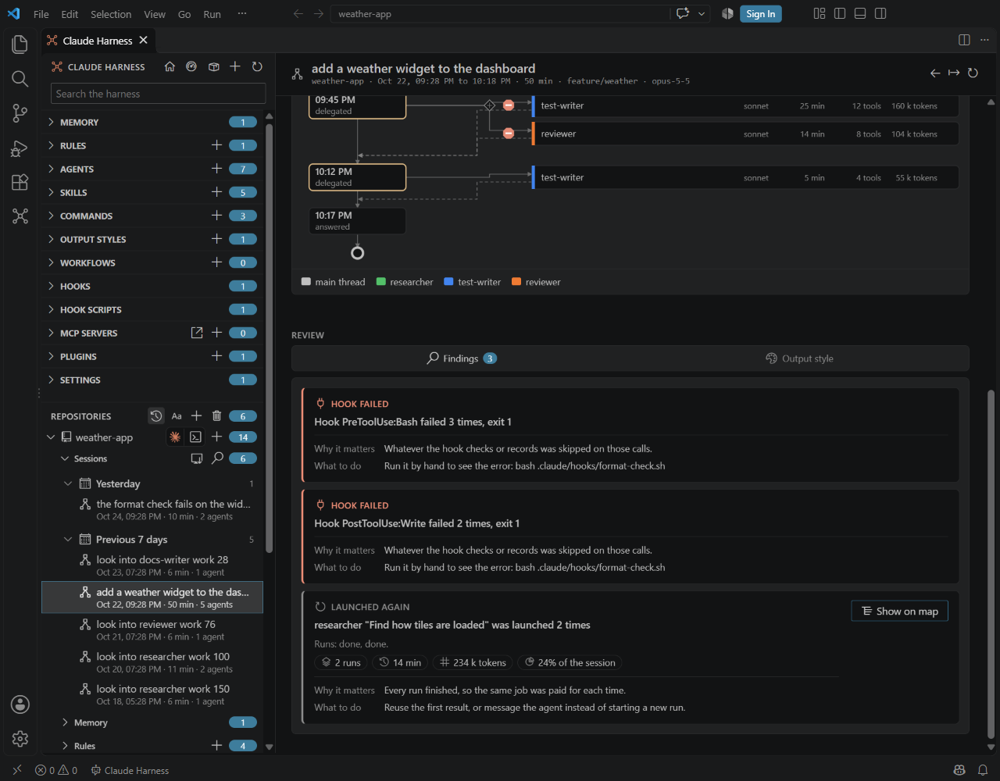
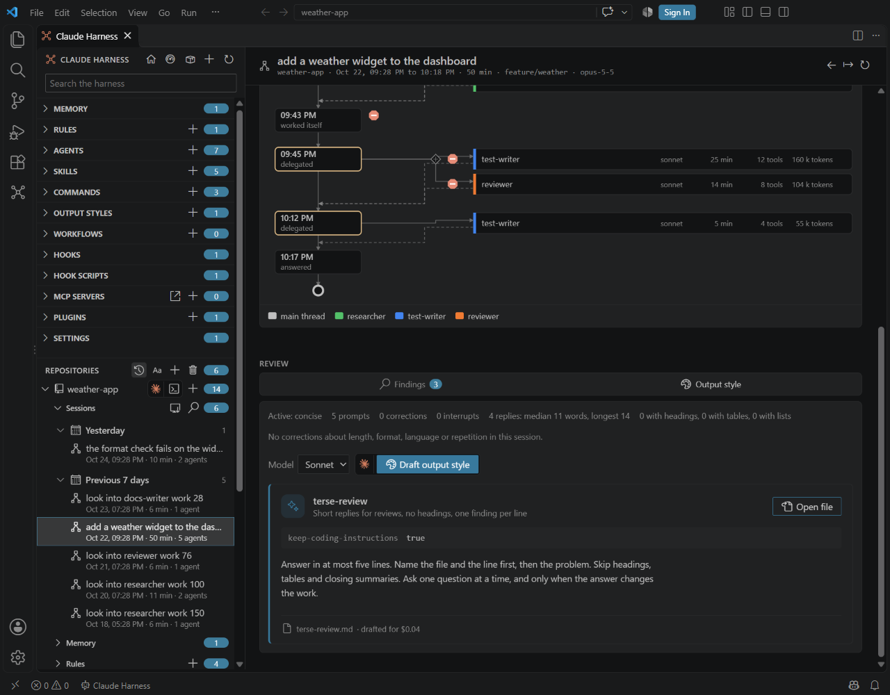
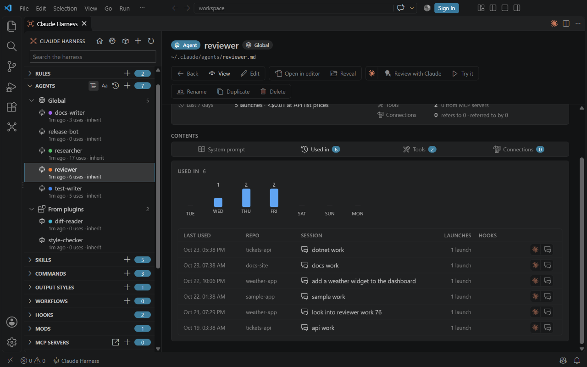
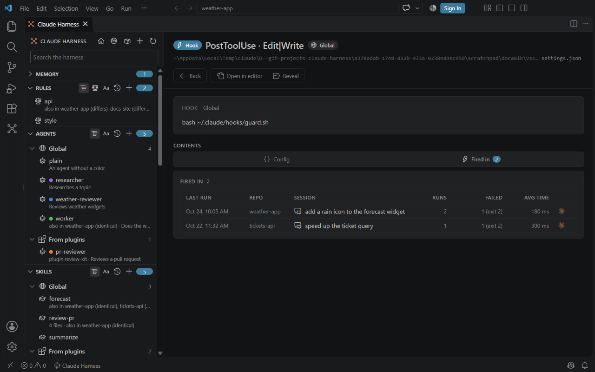
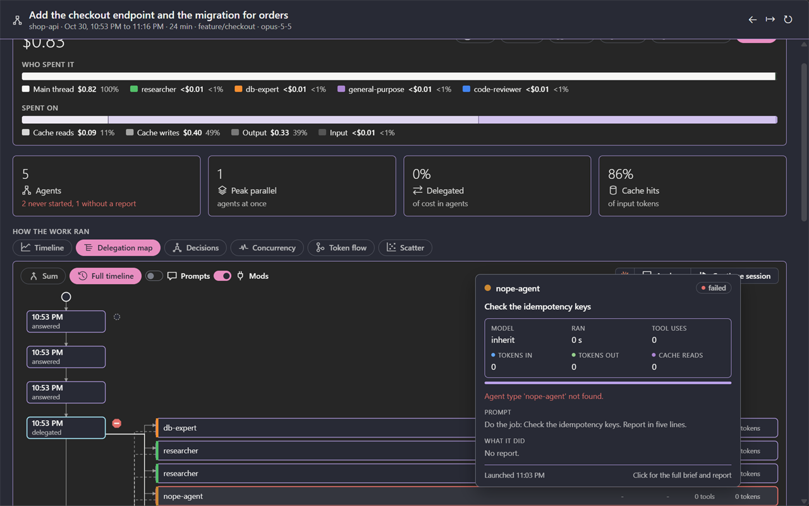

# Sessions

<table width="100%" border="1" cellpadding="10" cellspacing="0">
<tr>
<td align="left"><a href="repositories.md">← Back to Repositories</a></td>
<td align="center"></td>
<td align="right"><a href="claude-md-lenses.md">→ Next: CLAUDE.md lenses</a></td>
</tr>
</table>

Claude Harness lists the Claude Code sessions that ran in each repo. A session page shows what the run cost, which agents it started and how the work was delegated. Open a session from the activity bar, the main window or a repo page.

| Section | Description |
| --- | --- |
| [Sessions in the tree](#sessions-in-the-tree) | The session rows under each repo in the activity bar |
| [Sessions page](#sessions-page) | The search box, its suggestions, filters and chips |
| [Several accounts](#several-accounts) | Sessions of more than one Claude config folder, and the last 7 days of each account |
| [Session page](#session-page) | The header, the cost, the four KPIs and the agent details |
| [How the work ran](#how-the-work-ran) | The six views of how the work was delegated |
| [Findings](#findings) | What stands out in a session, what it cost and what to do |
| [Draft an output style](#draft-an-output-style) | Claude drafts an output style from the session |
| [Used in](#used-in) | The sessions that used an element, with the Used column and the other Used in tabs |
| [Hover cards](#hover-cards) | The cards for agents, the main thread and repos |

## Sessions in the tree

Each repo in the activity bar expands to its sessions, newest first. A session row shows its name, its date, its duration, its agent count and whether it is running now. Hover a row for a card with a heading (**Session**, **Running now** or **Headless session**), the first prompt, and the repo, branch, date and agent count; it never shows the path of the transcript. Headless `claude -p` runs started from a session's scratchpad folder appear under that session.

A session is named the way Claude Code's `/resume` names it: its agent name, then its custom title (set with `/rename`), its AI-generated title, its summary, its first prompt, and last the first 8 characters of its id.

Click a session row to open its session page. The **Open Session** command runs from these rows. See [Commands](commands.md).

Right-click a session row and choose **Rename Session...** to change its name. An input box is prefilled with the current name; Enter writes it the way `/rename` does, so `/resume` shows the new name too, and Escape or an empty name changes nothing. The command is also in the palette, where it first asks which session.

The **Sessions** node has an import button. It adds a Claude Code transcript (a `.jsonl` file) to that repo's account, so the session can be resumed there with `claude --resume`.

## Sessions page

An open repo in the main window shows a **Sessions** node first, above **Memory**, with its count. Click the search icon to open the Sessions page. Click the row, or its chevron, to fold or unfold the 10 newest sessions inline, with **Show all**. The repo page's **Sessions** tab lists its sessions the same way, with the 10 newest and **Show all**. See [Main window](main-window.md#sidebar) and [Repositories](repositories.md#repository-page).

The results, the repo page's Sessions tab and the Headless runs of a session are the same one-line table: Session, Branch, Started, Duration, Agents and State, with an Analyze button on each row of the search. A narrow panel drops the Branch column first. The head of the page shows the repo name, with its path in the hover.

The Sessions page has one search box. Suggestions appear when you type or press the arrow keys, and they narrow as you type. A filter shows only when a session matches it:

| Suggestion | Narrows to |
| --- | --- |
| Running now | Sessions that are running |
| Started today | Sessions that started today |
| With agents | Sessions that started at least one agent |
| With headless runs | Sessions that have headless `claude -p` runs |
| A hook failed | Sessions in which a hook ended with an error. See [Findings](#findings). |
| A mod denied a tool | Sessions in which a hook or mod refused a tool call |
| `Agent: <type>` | Sessions with an agent of that type |
| `Branch: <name>` | Sessions on that branch |
| Matching sessions | Sessions whose title matches what you typed. Choose one to open it. |

A chosen filter becomes a chip. Press Backspace in an empty box to remove the last chip. Press Esc to clear the text and all chips. Matches are highlighted in the results.

Each row ends in an **Analyze** button. It opens a new Claude in a terminal with a copy of that session, the same as [Analyze](#delegation-map) on the session page, and a card under the button says what happens first. The row itself still opens the session.



## Several accounts

When `claudeHarness.accounts` lists more than one Claude config folder, the sessions of every account are listed together, newest first, and each session shows the label of its account before its date. The session header shows it too, and the **Billing** switch of the cost row starts on the plan set for that account. See [Settings](settings.md#several-accounts) for the setting. With one account, nothing is labeled.

### Last 7 days

The **Models** tab of a repo page sums what each account used in the last 7 days, or since the last reset of its weekly limit when `weekStart` is set for it (see [Settings](settings.md#several-accounts)). Its heading then reads **Since** and the date. The totals cover all repos of the account and include the agents' transcripts. Each account has its own block, headed by its tokens and cost. The block is made of one-line tables with the columns Tokens, Cost, Of limit (only on a plan) and Replies, or Launches for agent types. Costliest rows come first. A reply that appears in more than one transcript, as after a resumed session, counts once.

The first table has a single row for the repo whose page you are on, with the tokens, cost and replies of its sessions and their agents. The tables **By model** and **By agent type** follow. Their hover cards say that they cover every repo of the account and not only this one. The agent type table lists each agent type with its tokens, cost and launches. An agent type that has a color in its definition shows that color as a swatch. The main thread is not counted in this group.

When the account has a plan, the block shows the cost as a share of that plan's weekly limit, and each model row reads for example `67.5% of limit`. Without a plan the rows show dollars. Team Premium and Team Standard also have a limit for the Fable model family (about $215 and $43), which gets a row of its own. The limits are estimates, because Anthropic publishes none. The tab reads the week again each time you open it.

The same week shows in two more places:

- The **overview** shows the cost and the number of sessions of the last 7 days for each repo, in its repository rows. See [Overview](main-window.md#overview).
- An **agent page** has a **Last 7 days** chip in its header, next to **Model** and **Color**, with the agent type's launches in the window and their cost at API list prices.



## Session page

The header shows the repo, the start and end, the duration, the branch and the model. Its export button saves the transcript as a JSONL file. Below it, the cost row shows the estimated cost at Anthropic API list prices. Two bars split the cost by **Who spent it** (the main thread and each agent type) and by **Spent on** (cache reads, cache writes, output and input).

The **Billing** switch in the cost row shows the same cost as a share of one weekly limit of your plan. Its options read Pro, Max 5x, Max 20x, Team (Team Standard), Team Premium and API, with the full name in the hover; API shows dollars. Anthropic publishes no weekly limit, so each limit is an estimate, and the switch's tooltip gives its figure. Pro and Team Standard are one fifth of Max 5x and of Team Premium. The headline reads **Weekly limit used** on a plan and **Estimated cost** on API billing.
Four KPIs follow the cost row:

| KPI | Shows |
| --- | --- |
| Agents | The number of agents that have a transcript, the same count as the sessions list. The note beside it counts the failed ones and those without a report, or reads "all reported back"; the longer text is in the hover. A launch that never started, such as one with an unknown agent type, is not counted: the note names it as "never started". |
| Peak parallel | The most agents that ran at the same time |
| Delegated | The share of the cost that ran in agents |
| Cache hits | The share of input tokens read from cache |


Below the KPIs, the **How the work ran** section shows how the work was split. Then come the agent details, a **Review** group and, when there are any, the headless runs. The Review group has two tabs in one box: [Findings](#findings) and [Output style](#draft-an-output-style). A tab shows only when the session has something for it. Click a lane or a node in the views to see that agent's brief, report, tools and tokens.

## How the work ran

The **How the work ran** section has six views behind one toggle bar. Each toggle shows a short hover. The legend that explains the marks sits inside the box of the view, under the diagram.

| View | Shows |
| --- | --- |
| Timeline | A lane per agent, next to your prompts. A ring round a prompt marks a checkpoint; see [Checkpoints in the Timeline](#checkpoints-in-the-timeline). A red circle with a white x marks a stopped agent. When a mod has events, a **Mods** toggle shows them as ticks. See [Mods in the Timeline](#mods-in-the-timeline). |
| Delegation map | Who started which agent. Its **Sum** and **Full timeline** modes are described below. |
| Decisions | What happened after each prompt: delegated, worked itself, followed up an agent, or answered. Its **Sum** and **Full timeline** modes are described below. |
| Concurrency | The agents that ran at the same time. Each agent run is one bar in its own lane, so the height is the number of agents running, and the peak is marked. |
| Token flow | The tokens from the session, through the main thread and each agent type, to the outcome. |
| Scatter | Each agent by run time and tokens. Dot area is the agent's cost, and the costliest dots are drawn first so smaller ones stay visible. Dashed lines are medians. Both scales are logarithmic. |

Lane colors come from the agent definition's own color field, or from the color a teammate was given. A color can be one of the eight names, a hex code or a CSS color name, and each is drawn as itself. A type without its own color takes a palette hue that no named type uses, for as long as one is left. Types that share a hue get a lighter and a deeper shade of it.

### Delegation map

The map shows who started each agent. Use it to follow a chain of agents back to the main thread. Two buttons above the diagram switch its mode. Each button shows a short hover. Four more buttons sit beside them: **Prompts**, **Mods**, **Analyze** and **Continue session**.

| Mode | Shows |
| --- | --- |
| Sum | Agents summed up by type under whoever started them. Click a type to drill down to its runs. |
| Full timeline | Your prompts as a process from top to bottom. Each delegation branches into the agents it started, and their reports join the main thread again. A team that ran together forks at a parallel gateway beside its prompt. |

The Full timeline opens by default. Every row, a type or a run, shows the same four facts in fixed right-aligned columns: the model (the runs for a type), the run time, the tool uses and the tokens. A type row in the Sum mode adds up the tokens of its runs. A value of zero or `-` still shows.

The buttons beside the mode buttons work in the Full timeline:

| Toggle | Shows | Starts |
| --- | --- | --- |
| Prompts | Each prompt as its own box on the main thread, above the step it started. Its first line shows inside the box, and the whole prompt is in its hover card. | Off |
| Mods | The events of every mod, one chip beside each step and on each agent connector the events concern. Click the toggle to switch all mods off or on together. | On. It appears only when a mod has events for the session. |
| Analyze | Opens a new Claude in a terminal with a copy of this session, to ask about it in a chat. The first use shows a card, which says what happens. A switch on the card remembers the answer, so the card is skipped from then on. The original session stays untouched. | Always, on a session page |
| Continue session | Resumes this very session in a terminal, so what you say is added to it. Analyze works on a copy instead. A card says what happens first. When the session is still running elsewhere, the card warns that two Claudes writing to one session mix their turns. | Always, on a session page |

Analyze runs `claude --resume <session-id> --fork-session` in the folder the session ran in, so the copy starts with the session's history. The first message tells the copy where the agents' transcripts are, so it can read the work inside an agent when you ask about it. The copy is a separate session, so it counts against your plan when Claude first answers.

Continue session runs `claude --resume <session-id>` in the same folder, without `--fork-session`. Claude reads the session again before it answers, which counts against your plan.

### Checkpoints in the Timeline

Claude Code saves a checkpoint of the files it edits at every prompt. The Timeline marks each prompt that has one with a ring round its dot. A session where Claude edited no file shows no rings.

Click a ring to open the checkpoint's detail under the diagram. It lists the files Claude changed after that prompt and that differ from the checkpoint now, each with what restoring does: overwrite, recreate or remove. Click a file to open it in VS Code's side-by-side diff, the file as it was at the prompt on the left and as it is now on the right. Click the ring again to close the detail.

| Button | Does |
| --- | --- |
| Restore files to here | Puts every listed file back as the checkpoint had it. A card names every file it will overwrite, recreate or remove, and nothing is written until you press **Restore files**. |
| Rewind the conversation | Opens this session in a terminal, as **Continue session** does, where Claude's own rewind takes the conversation back to the prompt. The extension never edits the transcript. A card says what happens first. |

A checkpoint holds only the files Claude changed with its own edit tools. **Restore files to here** undoes those edits back to the prompt, not the whole folder. Changes made by shell commands or by hand are not in a checkpoint, and a file Claude edited is overwritten even when you changed it again by hand afterwards.

### Mods in the Timeline

When a mod has events in the session, the Timeline gets a **Mods** toggle above its lanes. It shares its state with the Mods toggle of the Delegation map, so one choice holds in both views. With it on, each event is a thin tick under the main thread's line, for an event that falls in a prompt's time window, or under the bar of the agent the event names. Events of a mod that sit close together merge into one tick. Hover a tick to see the events behind it.

### Mod events

A mod can log what its hooks did in each session. The Mods toggle shows those events on the steps and agents they concern. A mod needs no manifest for this: its hook traces in the transcript already appear under the Mods toggle. A manifest adds a log with more detail.

A plugin adds its log by shipping `.claude-plugin/harness-events.json` in its plugin folder:

```json
{
  "label": "My mod",
  "events": "{sessionDir}/my-mod-events.jsonl"
}
```

| Manifest field | Required | Meaning |
| --- | --- | --- |
| `label` | Yes | The name of the mod's layer. It names the chips and the group on the Mods toggle. |
| `events` | Yes | The path of the session's log, as a template. The placeholders are `{sessionDir}` (the transcript path without `.jsonl`), `{sessionId}` and `{home}` (your home folder). Use forward slashes. A relative result resolves against the plugin folder. |

Both fields must be non-empty strings. Without both, the plugin adds no layer. A session has a layer only when its log exists and holds at least one event.

The log holds one JSON object per line:

```json
{"at":"2026-10-23T09:14:02Z","hook":"PreToolUse","text":"Blocked an edit to a generated file.","label":"guard","tone":"warn","agentId":"a1b2c3","detail":"generated/schema.ts is written by the build."}
```

| Log field | Required | Meaning |
| --- | --- | --- |
| `at` | Yes | When the hook decided, as an ISO 8601 time in UTC. It must parse as a date. |
| `hook` | Yes | The hook that acted, as text. |
| `text` | Yes | One plain sentence: what the plugin did. |
| `label` | No | A short chip label. Events without one show only in the hover card. |
| `tone` | No | `act` (the default), `warn` or `quiet`. A `quiet` event does not add its label to the chip. |
| `agentId` | No | The subagent the event concerns. The event shows on that agent's row. Other events show on the prompt whose time window holds them. |
| `detail` | No | Verbatim text the plugin injected or answered with. The hover card shows it in full. |

Lines that are not JSON, or lack `at`, `hook` or `text`, are skipped. Other fields are dropped. The events are shown in time order.

Without a manifest, the Mods toggle shows the hook traces of the transcript: what a hook added as context, wrote as output, showed as a message, blocked or failed, and each tool call that a hook denied. A trace is grouped under the `<name>: ` that its text opens with, where the name is lowercase, such as `my-mod: `. When that name is a plugin with a manifest, the trace joins the manifest's `label`. A trace with no such prefix goes under **Hooks**. A trace whose text a log already holds is shown once.



### Decisions

The Decisions view shows what the main thread did after each of your prompts. Two buttons above the diagram switch its mode. The explanation of the marks is in the hover of the tab.

| Mode | Shows |
| --- | --- |
| Sum | Your prompts summed up by what the main thread did, which agent or team it used, and how that ended. |
| Full timeline | Every prompt in order, with what the main thread did, the agent it launched or its team, and each team member. This is the default. |

Click a node with a `▸` to open it and see what is below it. Click a node with a `▾` to fold it again. The Sum mode opens its first three levels, and the Full timeline opens every level.



### Token flow

The Token flow view traces the tokens from the session to the outcome.



## Findings

The **Findings** tab of the Review group on a session page names what stands out in the run. Warnings come before notes. Each finding is a card:

- A kind label, such as **Failed**, **Stopped**, **No report**, **Hook failed** or **Main-thread edits**, so the severity never rests on color alone.
- One line of evidence: what happened.
- Cost chips with the time and the tokens of the runs it names, and their share of the whole session, taken from the same figures as the map rows.
- **Why it matters** and **What to do**.
- On a finding that names an agent, a **Show on map** button that opens the Delegation map, selects the agent's row, folds open the groups above it and centers it.

| Finding | When it shows |
| --- | --- |
| Failed | An agent run failed. The text gives the first line of its error. |
| Stopped | An agent was stopped. It says whether you stopped it on purpose, judged from a prompt of yours shortly before. It is a note instead of a warning when a later run of the same type finished the job. |
| No report | An agent never reported back. |
| Generic agent | An agent ran as `general-purpose`, and one of your agents fits the run's description. The finding names that agent. A general-purpose run that no agent fits gets no finding. |
| Follow-ups | An agent got messages after it reported. |
| Launched again | The same job was launched more than once. |
| Hook failed | A hook failed, with its event, how often and its exit code. It says which command to run by hand. |
| Main-thread edits | The main thread made 10 or more file edits, more than all agents together. The finding gives the share of the edits. |

The same hook failures show on the repo page: see [Plugins and hooks](effective-harness.md#plugins-and-hooks). The sessions list can filter to them with **A hook failed**.



## Draft an output style

The **Output style** tab of the Review group on a session page reads how replies should look from the transcript: the active style, your corrections about length, format, language or repetition, the interrupts, and the length and format of the replies. Choose a model in the **Model** select, then click **Draft output style**. A card says what happens first: Claude runs `claude -p` on your own login, counts against your plan, and receives the scan of the session without code or whole replies. The draft is saved as a new file in the repo's `output-styles` folder.

The drafted style shows as one region under the button: its name and description, its settings, every instruction in full, and a footer with the file name and what the draft cost. **Open file** opens it in the editor. While Claude writes, a placeholder region holds the space, and a failed draft shows an error region in its place.



## Used in

On the page of an agent, skill, command or output style, the **Used in** tab lists the sessions that used the element, newest first. Its count is the number of sessions. A 7-day strip above the table shows the uses of each of the last 7 days, today last, with a hover for each day. Plugins, rules and CLAUDE.md files have a tab of this kind too; see [Other Used in tabs](#other-used-in-tabs).

| Column | Shows |
| --- | --- |
| Last used | When the element was last used in that session |
| Repo | The repo the session ran in |
| Session | The session's first prompt. Click it to open the session page, when a repo in the harness holds the session. |
| Launches or Uses | Agent launches, on an agent page. Skill calls and typed slash commands, on a skill page. Runs of the command, on a command page. |
| Hooks | On an agent page only. What hooks and mods did inside that agent's run: tool calls they denied and hooks that failed. A dash when none did. |
| Analyze button | Opens a new Claude with a copy of that session, without opening the row. |

Opening the tab reads the Claude Code transcripts of every account, with the transcripts of their agents beside them, and keeps an index in the extension's global storage. The first open builds the index and shows its progress, such as `Indexing 120 of 800 transcripts`. Later opens read only the transcripts that changed. The transcripts are never changed.

An agent counts each launch by the agent type it named, and a launch without a type counts as `general-purpose`. A plugin's element counts under the name its transcripts use, `plugin-name:element`. A headless run started from a session's scratchpad counts under the repo of that session.

A global agent or skill leaves out the sessions of any repo that has its own copy of it. A repo's copy of a global element counts only the sessions run in that repo.

An output style counts the sessions that ran with it, matched by the `name` in its frontmatter.



### Other Used in tabs

| Page | Tab | What it shows |
| --- | --- | --- |
| Plugin | **Used in** | One row per skill, agent and command of the plugin, with its kind, when it was last used, the sessions and the uses, most used first. The plugin's **Skills** and **Agents** tabs show each element's use count, or "never used". |
| Rule, CLAUDE.md or other memory file | **Loaded in** | The sessions that loaded the file, with a **Loaded** column: **At start** for a file read when the session began, **Matched** and the glob for a rule that loaded when Claude read a file it matches, or **Read in its folder**. |
| Hook or hook script | **Fired in** | The sessions where the hook ran, newest first, with the runs, the failures with the last exit code, and the average time. A run is a successful run, a failure or a blocking error. A run is matched to a declared hook by its command first, then by its event and matcher. The matcher must take the tool of the run: it is a pattern that matches the whole tool name, and an empty matcher or `*` takes any tool. A run with no tool matches only a hook without a matcher. A run whose command is not declared, such as a plugin hook or a deleted hook, counts toward every declared hook with that event and matcher. A hook script counts the hooks whose command runs the script. A hook declared in a repo counts only the sessions inside that repo. The first open builds the index. |

A rule with `paths:` that no session ever loaded shows a **Never matched** marker: no session read a file that matches its paths. A rule with no paths loads in every session, so it never carries the marker.



### Used column on the type pages

The Agents, Skills and Commands type pages have a **Used** column with the use count and when the element was last used, such as `12 · 3 d ago`. Two presets join the filters: **Never used** and **Not used in 30 days**. The Skills page also has **Desc** and **Cost** columns; see [Skill size](editing.md#skill-size). The column and the presets need the index, which the first open of any Used in tab builds. Until then the column reads `not counted yet`, its hover says how to count, and a **Count usage** button in the page header builds the index on your click (it reads once, then shows **Counting...**). A type page only reads the index, it never builds it.


## Hover cards

Hover an agent lane to see its card. It shows the agent type and teammate name, the status, the description, the model, the run time, the tool uses, the tokens in and out, and the cache reads with a bar. It also shows 3 lines of the prompt and 6 lines of what it did, which is the agent's report. A fork lane adds a note on what a fork is.

The card on the **Main thread** lane shows the model, the run time, the prompt count, the tool uses, the file edits, the agents started, the tokens, the top tools and the estimated cost.



Hovering a repo row in the main window sidebar shows a card with the repo path, its check status (with a harness standard provider), its harness item counts, its session and agent totals, and the first prompt of its latest session.

---

<table width="100%" border="1" cellpadding="10" cellspacing="0">
<tr>
<td align="left"><a href="repositories.md">← Back to Repositories</a></td>
<td align="center"><a href="#sessions">↑ Back to top</a></td>
<td align="right"><a href="claude-md-lenses.md">→ Next: CLAUDE.md lenses</a></td>
</tr>
</table>
