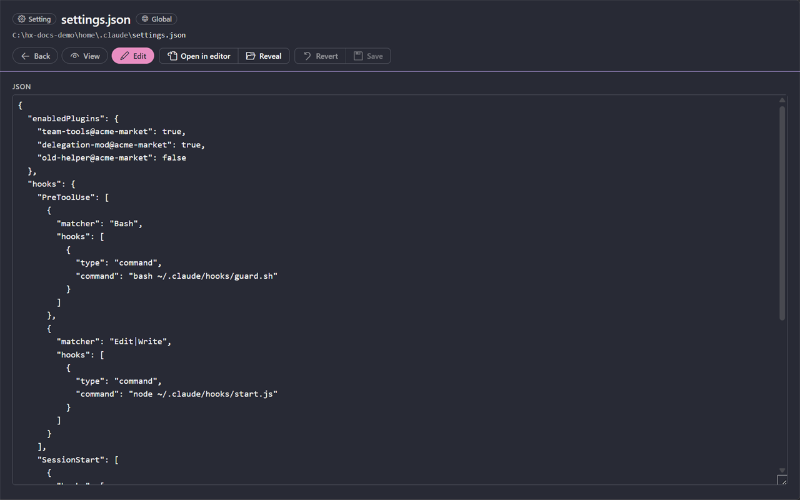

# Settings

<table width="100%" border="1" cellpadding="10" cellspacing="0">
<tr>
<td align="left"><a href="skill-sources.md">← Back to Skill sources</a></td>
<td align="center"></td>
<td align="right"><a href="commands.md">→ Next: Commands</a></td>
</tr>
</table>

Claude Harness has VS Code settings in four groups, **General**, **Terminals**, **Quota** and **Lists**. Find them under **Claude Harness** in the Settings editor. The six General settings control what Claude Harness lists. The two repo lists are stored in your user settings. Use **Add Repo** and **Remove Repo** to change them, because those commands update the settings for you.

| Setting | What it does | Default |
| --- | --- | --- |
| `claudeHarness.root` | The folder of the global harness. Empty means `~/.claude`. | Empty |
| `claudeHarness.repoFolders` | Folders added with **Add Repo**. Each is a repo folder or a parent folder. | `[]` |
| `claudeHarness.removedRepos` | Repo folders hidden with **Remove Repo**. Adding the repo or its parent folder again shows it. | `[]` |
| `claudeHarness.plan` | The plan of the account in the global harness folder: Pro, Max 5x, Max 20x, Team Standard, Team Premium or API billing. | Empty |
| `claudeHarness.weekStart` | When the weekly limit of the main account resets, as weekday and UTC hour, for example `Mon 11:00`. | Empty |
| `claudeHarness.accounts` | More Claude accounts on this machine, each `{ "label", "path", "plan", "weekStart" }`. | `[]` |

Changing `claudeHarness.root` reloads the global harness from the new folder, and the new folder is watched for changes.

### Terminals

Every terminal Claude Harness opens (Open Claude Here, New Claude Terminal, Review, Slim, Try it, Fix, Consolidate, Analyze, Continue, the MCP sign-in, plugin install and uninstall, and marketplace rename) follows these settings.

| Setting | What it does | Default |
| --- | --- | --- |
| `claudeHarness.terminal.location` | Where the terminals open: `editor` for the editor area, `panel` for the bottom panel. | `editor` |
| `claudeHarness.terminal.openToSide` | Opens a terminal beside the open files instead of in their group. Applies when the location is `editor`. | `true` |
| `claudeHarness.terminal.command` | The command or full path that starts Claude. Empty means `claude`. | `claude` |
| `claudeHarness.terminal.args` | Extra arguments added right after the command when an interactive session starts, for example `--model sonnet`. Plugin install, uninstall and marketplace commands do not get them. | Empty |

### New Claude Terminal and image paste

**Claude Harness: New Claude Terminal** (Ctrl+F1, and the Claude mark button in the title bar of the editor) opens a terminal and runs `claude` in it. It starts in the folder of the active editor's workspace folder, else the first workspace folder, else your home folder. Each new terminal has its own name: Claude, Claude (2), Claude (3).

On Windows, **Claude Harness: Paste Image into Claude** (Ctrl+V while a terminal has focus) pastes a screenshot into Claude Code. When the clipboard holds an image and no text, the image is saved as a PNG in the `claude-harness-images` folder of your temp folder, and its path is typed into the terminal without pressing Enter. A clipboard with text pastes as usual.

### Claude usage in the status bar

The status bar shows your Claude limits as `5h 12% · wk 47%`: the share used of the 5-hour session and of the weekly limit. The limits are read live from your Claude account with the sign-in that Claude Code keeps in the global harness folder, so nothing is shown while you are signed out. The item turns to the warning color at the warning share and to the error color at the critical share.

Hover the item for one bar per limit, with the weekly limit of a single model on its own bar. The fill is the share used, the tick is how much of the window has passed, and the two lines mark the warning and critical shares. The time until the limit resets sits next to the bar: `hh:mm` for the 5-hour session and `dd:hh:mm` for the weekly limits. The card ends with the time of the last read. While a read fails, the item keeps the last values and says so. Click the item to open Claude Harness.

| Setting | What it does | Default |
| --- | --- | --- |
| `claudeHarness.quota.enabled` | Shows the item and reads the limits. Turn it off to hide the item and stop the requests. | `true` |
| `claudeHarness.quota.warnPercent` | The used share at which the item turns to the warning color and the bars turn amber. | `75` |
| `claudeHarness.quota.criticalPercent` | The used share at which the item turns to the error color and the bars turn red. Not lower than the warning share. | `90` |
| `claudeHarness.quota.activeRefreshSeconds` | Seconds between reads while Claude was used in the last 10 minutes. | `60` |
| `claudeHarness.quota.idleRefreshSeconds` | Seconds between reads while Claude is idle. | `120` |

### List lengths

These settings set how many rows a list shows before its show all control. A change applies without a reload.

| Setting | What it does | Default |
| --- | --- | --- |
| `claudeHarness.lists.sessions` | Sessions listed in the sidebar and on a repo page. | `10` |
| `claudeHarness.lists.recentRepos` | Recently changed elements listed on a repo page. | `10` |
| `claudeHarness.lists.huntCatalog` | Catalog entries listed in the [Plugin Hunter](plugins.md#plugin-hunter) picker before the search must be narrowed. | `60` |
| `claudeHarness.lists.decisions` | Decisions shown on one card of the Decisions view. | `6` |

### Several accounts

Claude Code reads its config folder from `CLAUDE_CONFIG_DIR`, so a machine with two seats can keep `~/.claude` and `~/.claude-work`. List each extra folder in `claudeHarness.accounts`:

```json
"claudeHarness.accounts": [
  { "label": "Work", "path": "~/.claude-work", "plan": "team-standard", "weekStart": "Mon 11:00" }
]
```

`path` is required, and a leading `~` is your home folder. The label defaults to the folder name, and an unknown plan counts as none. The main account, from `claudeHarness.root`, is labeled **Default**; give it a plan with `claudeHarness.plan`. A folder that repeats an earlier one is ignored. `weekStart` is the weekday (`Mon`, `Tue` and so on, or the full name) and the UTC hour, with optional minutes, at which the weekly limit of the plan resets, for example `Mon 11:00` or `Thu 9:30`. Find it in the usage card of the Claude app, and convert to UTC. A value in another form is ignored. With the list empty nothing changes. Only the sessions come from the extra folders: the harness items you edit still come from the main folder.

With more than one account, each session in the sidebar, the sessions page and the session header shows the label of its account, and the cost row starts on that account's plan. See [Sessions](sessions.md#several-accounts).

See [Repositories](repositories.md) for how the two repo lists are used.

## Edit settings files

The **Settings** category lists `settings.json` and `settings.local.json` for the global harness and for each repo, when the file exists. Click a file to open it, then click **Edit** to change it in an editable JSON box.

| Action | How |
| --- | --- |
| Save | Click **Save**, or press Ctrl+S. Save is available only when the text has changed. |
| Revert | Click **Revert** to drop your changes |

Save checks the JSON first. Invalid JSON shows an error with the parser message, and the file stays unchanged. The file keeps its line endings, whether they are CRLF or LF.



**Claude Harness: Open Settings File...** lists every settings file, global and per repo, and opens the one you pick. See [Commands](commands.md#open-settings-file).

---

<table width="100%" border="1" cellpadding="10" cellspacing="0">
<tr>
<td align="left"><a href="skill-sources.md">← Back to Skill sources</a></td>
<td align="center"><a href="#settings">↑ Back to top</a></td>
<td align="right"><a href="commands.md">→ Next: Commands</a></td>
</tr>
</table>
