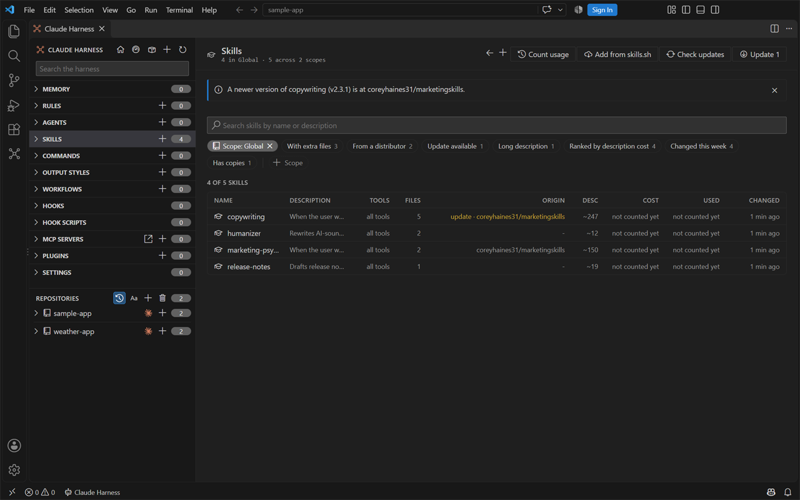
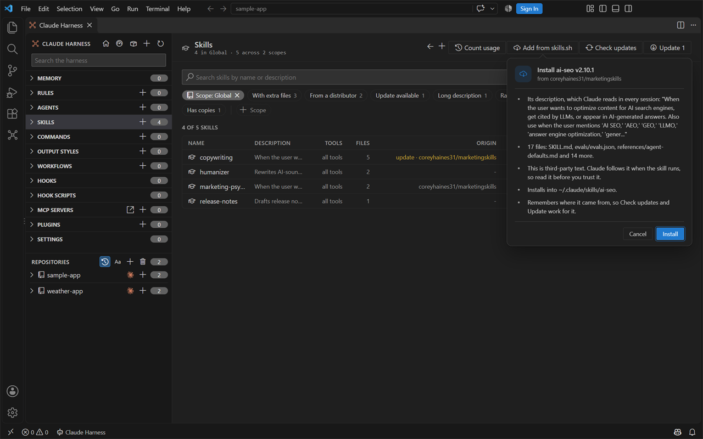
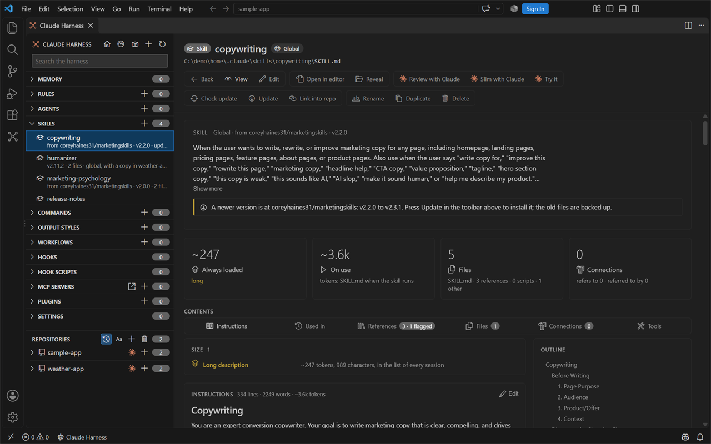
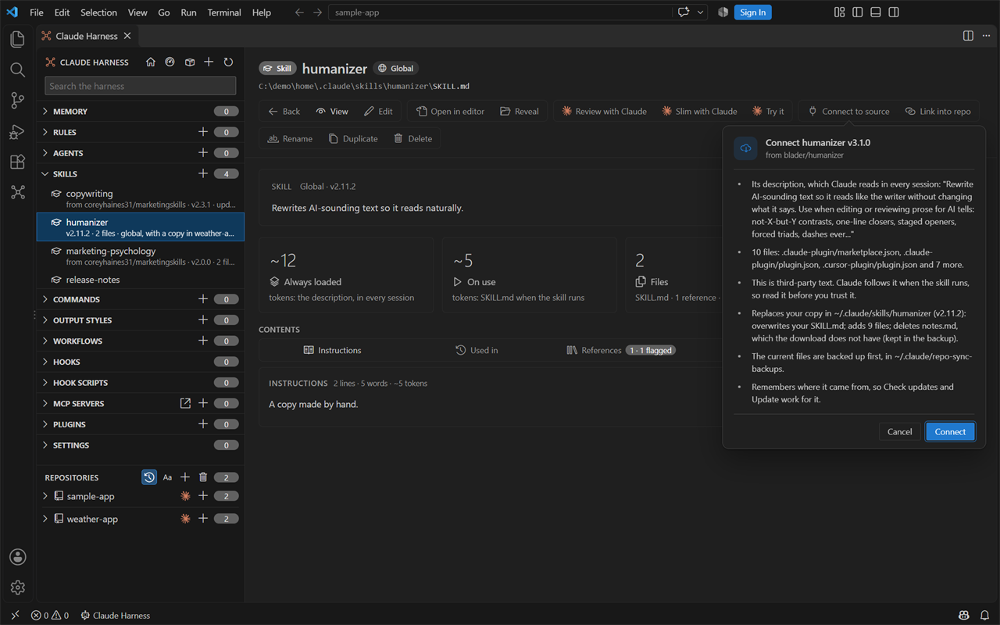
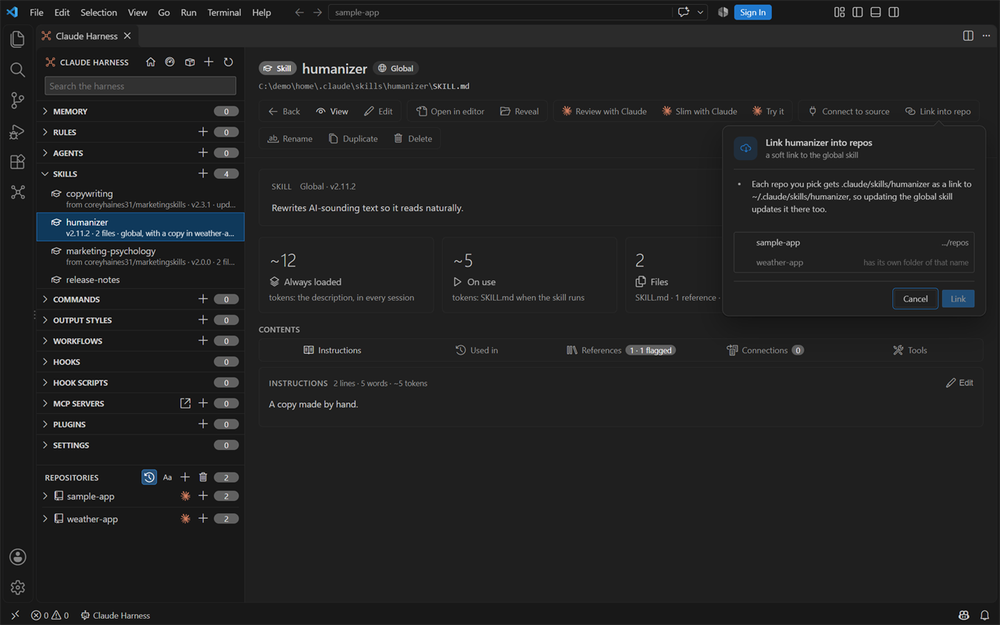

# Skill sources

<table width="100%" border="1" cellpadding="10" cellspacing="0">
<tr>
<td align="left"><a href="plugins.md">← Back to Plugins</a></td>
<td align="center"></td>
<td align="right"><a href="settings.md">→ Next: Settings</a></td>
</tr>
</table>

Skills from [skills.sh](https://www.skills.sh) or any public GitHub repository can be added, checked for a newer version and updated from the Skills page, so you do not copy files by hand. Claude Harness remembers where each skill came from.

## Add a skill from skills.sh or GitHub

Click **Add from skills.sh** in the header of the Skills page, or run **Claude Harness: Add Skill from skills.sh or GitHub...**. A card asks for the address. These forms work:

| Address | Example |
| --- | --- |
| A skills.sh page | `https://www.skills.sh/coreyhaines31/marketingskills/ai-seo` |
| A GitHub repo or a folder in it | `https://github.com/blader/humanizer`, `https://github.com/coreyhaines31/marketingskills/tree/main/skills/ai-seo` |
| Owner, repo and skill | `coreyhaines31/marketingskills/ai-seo` |

If the address is wrong, the card says what is wrong: an unsupported site, a missing repo, or a name with characters a repo cannot have. If the repo has several skills and the address names none, or the name is not in it, the card lists the repo's skills, sorted, to pick from.

Before anything is written, a card shows what you are about to install:

- the skill's description, which Claude reads in every session,
- the number of files and the first few names,
- a reminder that a skill is third-party text that Claude follows when it runs, so it is worth reading first,
- where the files go, and the backup of anything they replace.

**Install** writes the skill's files into `~/.claude/skills/<name>`, like a skill you made yourself, and records its source. The row is scrolled into view and flashes once, and a line above the table says what was installed. A skill that is already installed from the same source is reported before anything is downloaded, with a **Check for updates** button on the line.

## The Origin and Sync columns

The **Origin** column on the Skills page says where a skill comes from in one word: `global`, `repo`, `linked`, `marketplace` or `distributor`. For a skill from a distributor, the hover card of the cell shows `owner/repo`, the path of the skill in the repo and when it was last checked. The skill's page also has a chip with `owner/repo` in its header.

The **Sync** column, which replaces Tools on the Skills page, says what the last check found. It is empty for a skill without a source.

| Cell | Meaning |
| --- | --- |
| `current` | Checked, and the skill is up to date. |
| `update` | The distributor has a newer version. |
| `unchecked` | Not checked yet in this session, or the last check could not reach GitHub or the repo. The skill itself is fine; the reason is in the hover card. |
| `gone` | The repo no longer has this skill. |

Two presets filter the page: **From a distributor** and **Update available**. A skill with a newer version also shows a banner on its page with the version pair, such as `v2.2.0 to v2.3.1`.

## Check for updates

**Check updates** in the Skills page header, or **Check update** on a skill's page, asks GitHub whether the skill's folder changed since it was installed. One request per repository answers for every skill from it, and nothing is downloaded. A change is found even when the SKILL.md carries no version number; when it does, the versions are shown, for example `copywriting (v2.2.0 to v2.3.1)`. The result is a line above the table with a dismiss button, and in the Sync column. **Sync** in the right-click menu of a skill that has a source does the check for that skill and, when it is newer, goes on to the update card.

Checks are never made on their own. GitHub allows 60 requests an hour without a token, so a fleet of skills from many repos can use them up. Set the environment variable `GITHUB_TOKEN` (or `GH_TOKEN`) before you start VS Code to raise the limit; the extension then sends it with its requests. When the limit is reached, the line says so.

## Update

**Update N** in the header updates every skill the last check found a newer version for. **Update** on a skill's page updates that one. A card lists what changes per skill, with the files named:

- which of your files are overwritten, and which files are added,
- which files are deleted because the download does not have them, such as notes you added to the folder,
- for a skill that was a link into `~/.agents` (see [below](#where-the-source-is-recorded)), that the link becomes a real folder.

The old files are backed up first, in `~/.claude/repo-sync-backups/<time>/skills/<name>`. A repo that links the skill (see [Link a global skill into a repo](#link-a-global-skill-into-a-repo)) picks up the update at once.

## Connect a skill you already have

A skill you copied by hand has no source yet. Open it and click **Connect to source** (**Claude Harness: Connect Skill to its Source...**). The card asks for the address, or just `owner/repo`, in which case the skill's own name is looked up in that repo. Then it shows what the distributor's files replace in your copy, with your changed and deleted files named, the same reminder as for a new skill, and where the backup goes. After **Connect**, checks and updates work for the skill.

## Link a global skill into a repo

A skill in `~/.claude/skills` loads in every repo. To keep one copy and still list it in a repo's own `.claude/skills`, click **Link into repo** on the skill's page (**Claude Harness: Link Global Skill into a Repo...**). A card lists your repos to pick from. Each picked repo gets `.claude/skills/<name>` as a soft link (a directory junction on Windows, which needs no admin rights) to the global folder, so an update of the global skill shows in every linked repo.

A repo that already has its own folder of that name, a link to somewhere else, or this link is shown disabled with the reason. Nothing is replaced. The skill's page then says `linked into <repo>` in its heading line, and the repo's skill shows as linked on the Skills page (preset **Linked**).

## Where the source is recorded

| File | Written by | Holds |
| --- | --- | --- |
| `~/.claude/.skill-sources.json` | Claude Harness | For each skill added, connected or updated here: `source` (`owner/repo`), `skillPath` (the SKILL.md in the repo), `skillFolderHash` (the git tree SHA of the skill's folder, which a check compares), and the installed and updated times |
| `~/.agents/.skill-lock.json` | The skills CLI (`npx skills add -g`) | The same facts for skills the CLI installed |

Claude Harness only reads the CLI's lock file, never writes it. A skill the CLI installed therefore shows `distributor` as its Origin and can be checked and updated here. The CLI keeps such a skill in `~/.agents/skills` and links `~/.claude/skills/<name>` to it; an update from Claude Harness replaces that link with a real folder in `~/.claude/skills` and leaves the copy in `~/.agents` as it was. Nothing is installed into `~/.agents`.

## Commands

| Command | What it does |
| --- | --- |
| Add Skill from skills.sh or GitHub... | The card for an address, then the install card |
| Connect Skill to its Source... | Connects a skill you already have to its address |
| Check Skills for Updates | Checks every skill with a source |
| Update Skills from their Source | Updates the skills the last check found newer, or checks first |
| Link Global Skill into a Repo... | Picks the repos that get a soft link to a global skill |

Run from the Command Palette, a question is a quick input, a pick list or a dialog, because a card belongs to the button you pressed. The result still appears as a line in the panel when it is open, and as a notification when it is not. See also [Commands](commands.md).

---

<table width="100%" border="1" cellpadding="10" cellspacing="0">
<tr>
<td align="left"><a href="plugins.md">← Back to Plugins</a></td>
<td align="center"><a href="#skill-sources">↑ Back to top</a></td>
<td align="right"><a href="settings.md">→ Next: Settings</a></td>
</tr>
</table>
