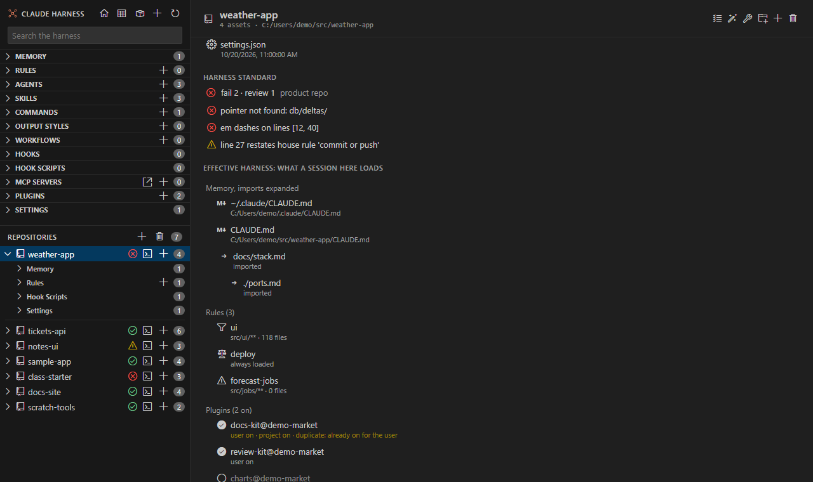
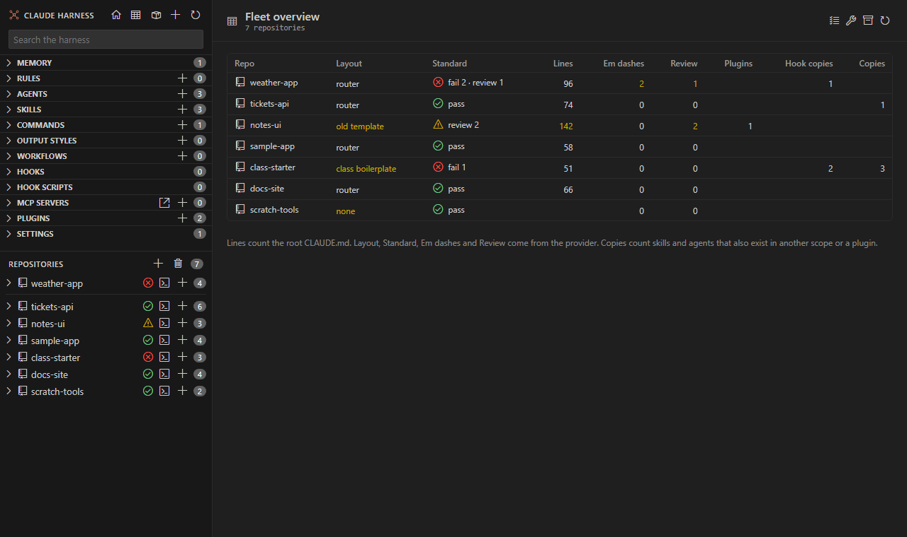
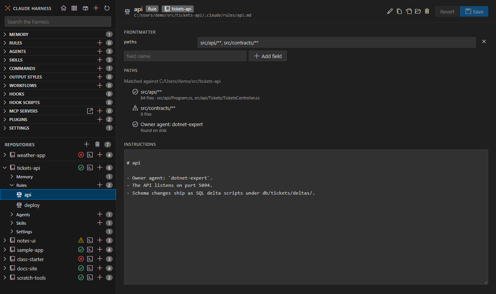
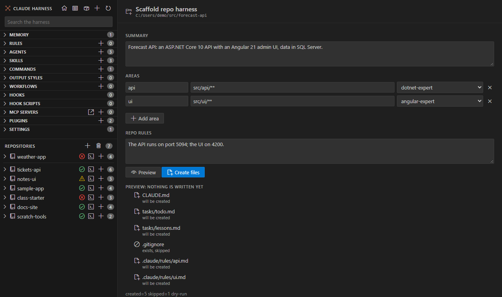

# Harness plugin: harness standard provider

This plugin is the harness standard provider for Claude Harness. It ships a manifest that points the extension at a check, a fix, a scaffold and the standard, and the extension shows the provider features only when the manifest is found. This page covers the manifest, the script contracts the extension calls and the features they enable.

| Section | Description |
| --- | --- |
| [Install](#install) | The marketplace and install commands, and the extension version it needs |
| [Manifest](#manifest) | The `harness-standard.json` fields and how the extension finds them |
| [Contracts](#contracts) | The arguments and output of the check, fix and scaffold scripts, and the align prompt |
| [Check Harness](#check-harness) | The check, its badges, the Problems panel and the repo page section |
| [Fleet columns](#fleet-columns) | The Layout, Standard, Em dashes and Review columns |
| [CLAUDE.md lenses](#claude-md-lenses) | Restated rules, boilerplate headings and dead paths in CLAUDE.md |
| [Owner agent check](#owner-agent-check) | The owner line check in the rules view |
| [Fix Settings and Hooks](#fix-settings-and-hooks) | The preview and apply flow for settings and hooks |
| [Scaffold Repo Harness](#scaffold-repo-harness) | The form that creates the harness files of a repo |
| [Align CLAUDE.md](#align-claudemd) | The command that runs the align prompt in a repo |
| [Open the Harness Standard](#open-the-harness-standard) | Opens the standard document |
| [Mentions](#mentions) | The `@harness:` mentions and their type-ahead |

## Install

The plugin is published in the `claude-harness` marketplace of the [claude-harness](https://github.com/alexander-kastil/claude-harness) repository. In Claude Code:

```
/plugin marketplace add alexander-kastil/claude-harness
/plugin install harness-plugin@claude-harness
/reload-plugins
```

From a shell:

```bash
claude plugin marketplace add alexander-kastil/claude-harness
claude plugin install harness-plugin@claude-harness
```

The `@harness:` mentions need the Claude Harness VS Code extension 0.8.0 or later. The plugin version follows the extension version.

## Manifest

The manifest is `.claude-plugin/harness-standard.json`. The extension reads it from each installed plugin and from each directory marketplace source.

```json
{
  "name": "integrations harness standard",
  "check": "skills/fix-constitution/scripts/check-constitution.py",
  "fix": "skills/fix-constitution/scripts/fix-settings.py",
  "scaffold": "skills/init-product-repo/scripts/init-product-repo.py",
  "standard": "skills/fix-constitution/references/standard.md",
  "align": "/harness-plugin:fix-constitution",
  "ownerPattern": "^\\s*-\\s*Owner agent:\\s*`([^`]+)`",
  "keepCopies": {
    "folders": ["demos", "labs"],
    "claudeMdPattern": "\\bcop(?:y|ies)\\b[^\\n]*\\b(?:kept|keeps?)\\b|\\bkeeps?\\b[^\\n]*\\bcop(?:y|ies)\\b"
  }
}
```

| Field | Required | Meaning |
| --- | --- | --- |
| `name` | No | The label the extension uses, for example in the Fleet overview footnote and in messages. Defaults to the plugin folder name. |
| `check` | Yes | Path to the check script. The extension ignores the manifest when this file does not exist. |
| `fix` | No | Path to the fix script. Enables Fix Settings and Hooks. |
| `scaffold` | No | Path to the scaffold script. Enables Scaffold Repo Harness. |
| `standard` | No | Path to the standard document. Opens from Open the Harness Standard. |
| `align` | No | A prompt string, not a path. Enables Align CLAUDE.md. |
| `ownerPattern` | No | A JavaScript regular expression, flag `m`, with one capture group for the owner agent name. Enables the owner agent check. |
| `keepCopies` | No | An object that marks the repos that keep their copies. `folders` lists folders that must all exist at the repo root. `claudeMdPattern` is a case-insensitive regular expression tested against the root `CLAUDE.md`. Our values: `folders` is `["demos", "labs"]`, and `claudeMdPattern` matches a line where "copy" or "copies" appears with "keep", "keeps" or "kept", in either order. |

Paths are relative to the plugin folder and use forward slashes.

A repo that matches `keepCopies` is not offered Retire. **Retire Copy** shows the reason, either "It has demos and labs, so it keeps its copies." or "Its CLAUDE.md says copies are kept.", and **Retire Clean Copies** leaves the repo out. Without a match, Retire is offered in every repo.

When several plugins ship the manifest, the extension tries directory marketplace sources first, then installed copies, and uses the first one whose `check` file exists. A newer directory source therefore wins over an older installed copy.

## Contracts

Scripts that end in `.py` run with the first working Python 3 of `python`, `py -3` and `python3`. Other scripts run directly. Without Python 3 the extension shows a message that names the three commands it tried.

### Check

Run: `<root> --json`

The extension reads the first stdout line that starts with `{`. The script exits with 1 when there is a FAIL, and the extension reads stdout either way.

```json
{"repo": "weather-app", "kind": "product", "layout": "router", "metrics": {"lines": 96, "emDashes": 2}, "fail": 2, "review": 1, "findings": [{"level": "FAIL", "code": "pointer", "text": "FAIL pointer not found: db/deltas/", "locations": [{"file": "CLAUDE.md", "line": 22, "token": "db/deltas/"}]}]}
```

| Key | Values |
| --- | --- |
| `repo` | Folder name of the repo |
| `kind` | `product` or `class` |
| `layout` | `router`, `class boilerplate`, `old template`, `other` or `none` |
| `metrics` | `lines` counts the root `CLAUDE.md`, `emDashes` counts its em dashes |
| `fail`, `review` | Counts of FAIL and REVIEW findings |
| `findings[].level` | `FAIL`, `REVIEW` or `INFO` |
| `findings[].code` | `restated`, `boilerplate`, `pointer`, `em-dash`, `lines`, `sections`, `hook` or `settings` |
| `findings[].text` | The message, with the level in front |
| `findings[].locations[]` | `file` relative to the repo with forward slashes, `line` (1-based, or null), and `token` when the line is found by a token |

Without `--json` the script prints one line per finding, then `repo=<name> kind=<kind> fail=<n> review=<n>`.

### Fix

Run: `<root> --global-settings <file> [--apply] [--keep-plugins]`

- Without `--apply` the script is a dry run and writes nothing.
- `--keep-plugins` leaves `enabledPlugins` and `extraKnownMarketplaces` as they are.
- The output is one line per change, then `repo=<name> changes=<n> dry-run` or `repo=<name> changes=<n> applied`.

Example change lines: `delete .claude/hooks/<file>` and `delete empty .claude/hooks/`.

### Scaffold

Run: `<root> --root <dir> --summary <text> --area name=glob[,glob]:owner --rule <text> [--fact area=text] [--apply]`

- `--area` repeats once per area. `--rule` repeats once per repo rule. `--fact` adds a line to an area's rules file.
- The output is one `create <path>` or `skip <path>` line per file, then `created=<n> skipped=<n> dry-run` or `created=<n> skipped=<n> applied`.
- The script creates `CLAUDE.md`, `tasks/todo.md`, `tasks/lessons.md`, `.gitignore` and one `.claude/rules/<area>.md` per area. An existing file is skipped, never overwritten.

### Align

The manifest `align` value is a prompt. The extension runs `claude "<align>"` in a terminal in the repo. There is no script.

## Check Harness

The **Check Harness** command runs the check on every repo, or on the repo you pick, and ignores the cached result. It was named **Check Harness Standard** before 0.1.31.



### Results

| Finding | Problems panel | Points to |
| --- | --- | --- |
| FAIL | Error | The file and line it concerns |
| REVIEW | Warning | The file and line it concerns |
| INFO | Information | The file it concerns |

A finding can concern `CLAUDE.md`, a file that `CLAUDE.md` imports, `.claude/settings.json`, `.claude/settings.local.json` or a file under `.claude/hooks/`. Each entry uses the source **harness standard**. Click an entry in the repo page to open the file at that line.

### Badges

| Badge | Meaning |
| --- | --- |
| pass | The repo passes the standard. The tree reads "passes the standard". |
| fail | At least one FAIL. The badge shows the count, for example "fail 2 · review 1". |
| review | No FAIL, and at least one REVIEW. |
| checking | A check is running. |

The badges show on the **Repositories** node in the activity bar and next to each repo in the main window sidebar. The repo row menu and the Repositories node carry the provider commands.

### When a check runs

A check runs when:

- You expand the **Repositories** node in the activity bar.
- The Fleet overview opens.
- A repo page opens.
- A repo's root `CLAUDE.md` is opened or saved.
- A file under the repo's `.claude` folder is saved.
- You run **Check Harness**.

A result stays until a file the check reads changes. Those files are `CLAUDE.md`, the files it imports, the two repo settings files, the repo's hooks folder and the global `settings.json`. At most three repos are checked at once.

### Missing provider or Python

If the manifest is missing or Python 3 is not on PATH, the check stays off. The badge shows a message that says what is missing.

## Fleet columns

When a provider is installed, the Fleet overview shows four more columns: Layout, Standard, Em dashes and Review. The footnote names the provider.



| Column | Source |
| --- | --- |
| Layout | `layout` from the check |
| Standard | The check result, with its badge |
| Em dashes | `metrics.emDashes` from the check |
| Review | `review` from the check |

The Lines column turns yellow above 120 lines only when a provider is installed. The Fleet toolbar adds **Check every repo against the harness standard** and **Fix settings and hooks...** only with a provider.

## CLAUDE.md lenses

The check feeds three kinds of CodeLens and quick fix on the root `CLAUDE.md` and `.claude/rules/*.md`:

| Finding `code` | Lens | Action |
| --- | --- | --- |
| `restated` | `restates house rule '...': Remove line` | Removes the line |
| `boilerplate` | `... its rules belong in Working Method: open the standard` | Opens the standard |
| `pointer` in `CLAUDE.md` | `Pointer not found: <path>: Repoint... \| Drop line` | Repoints or removes the line |


Skill and agent pointers and rules-file paths do not depend on the check. The extension finds them on its own.

## Owner agent check

With `ownerPattern` set, the rules view reads the owner agent from the rule body and checks it against the agents on disk.

| State | Text |
| --- | --- |
| Owner found | `Owner agent: <name>`, "found on disk" |
| Owner missing | `Owner agent: <name>`, "no agent with this name on disk" |
| No line | "No Owner agent line" |



## Fix Settings and Hooks

The fix runs the `fix` script on a repo's `.claude` settings and hooks. It shows what the script would change before anything is written. Nothing changes until you choose **Apply**.

### Start a fix

- The wrench button on a repo page.
- **Fix Settings and Hooks...** in a repo row menu or in the Repositories node menu.
- The wrench button on the Fleet overview, or the command in the palette. The command asks which repos to fix.

The bulk-edit guard (see the Claude Harness docs) may leave out repos before the preview runs.

### Choose what may change

| Choice | Effect |
| --- | --- |
| Fix plugins, marketplaces and hooks | The script may change plugin settings, marketplace entries and hooks. |
| Keep plugin settings | Runs with `--keep-plugins`. Only replaced hooks are removed. |

### Review and apply

1. The script runs as a dry run against the repo. Nothing is written.
2. The script runs with `--apply` on a temporary copy of `.claude/settings.json`, `.claude/settings.local.json` and `.claude/hooks/`.
3. A diff editor opens for each changed file, comparing the repo file with the copy after the fix. Up to eight diffs open.
4. A confirmation lists the change lines for each repo. **Apply** runs the script with `--apply` on the repo.

If a fix would change nothing, the extension says so and opens no diff. If the script fails in one repo, the others still run.

## Scaffold Repo Harness

**Scaffold Repo Harness** creates the harness files for a repo. It was named **Init Product Repo** before 0.1.31. You fill in a short form, preview the files, and then create the missing ones. The scaffold never overwrites a file.



### Fill in the form

| Field | What to write |
| --- | --- |
| Summary | One to three sentences: what the product is and its stack |
| Areas | A name, the globs of its files, and an owner agent. Use commas or new lines between globs. |
| Repo rules | One repo-only hard rule per line |

The owner agent list shows the agents on disk. If an owner name is not on disk, the form reports it.

### Preview and create

**Preview** runs the script as a dry run. It lists each file as **will be created** or **exists, skipped**. Nothing is written.

**Create files** is enabled only after a preview of the same form. It creates the missing files and skips the rest. A created repo is added to `claudeHarness.repoFolders`, so it appears in the sidebar.

### Open the form

- The new-folder button on a repo page.
- **Scaffold Repo Harness...** in a repo row menu. It opens for that repo.
- **Claude Harness: Scaffold Repo Harness...** in the command palette. It asks for a folder first.

## Align CLAUDE.md

**Align CLAUDE.md...** runs the `align` prompt for a repo. It appears in the repo row menu and as the wand button on a repo page.

1. The bulk-edit guard (see the Claude Harness docs) checks the repo. Nothing runs when the guard leaves it out.
2. A terminal named `Align: <repo>` opens in the repo folder and runs `claude "<align>"`.

## Open the Harness Standard

**Open the Harness Standard** opens the `standard` document from the manifest. It is in the palette, and a CodeLens on a boilerplate heading offers it.

## Mentions

Type `@h` in a prompt to list the Claude Harness views: `@harness:inventory`, `@harness:consolidate`, `@harness:agents`, `@harness:usage`, `@harness:delegation` and `@harness:hunt`. `@harness:u` narrows the list. When you send the prompt, each mention runs the matching command of the Claude Harness command line once, and Claude reads its output as context; the prompt keeps the text you typed. `usage` and `delegation` read the latest session in the folder Claude Code runs in.

The rows come after Claude Code's own rows for files, agents and MCP resources. Only views that read and need no arguments are mentions; the commands that write run from a terminal.

Needs the Claude Harness extension 0.8.0 or later.
