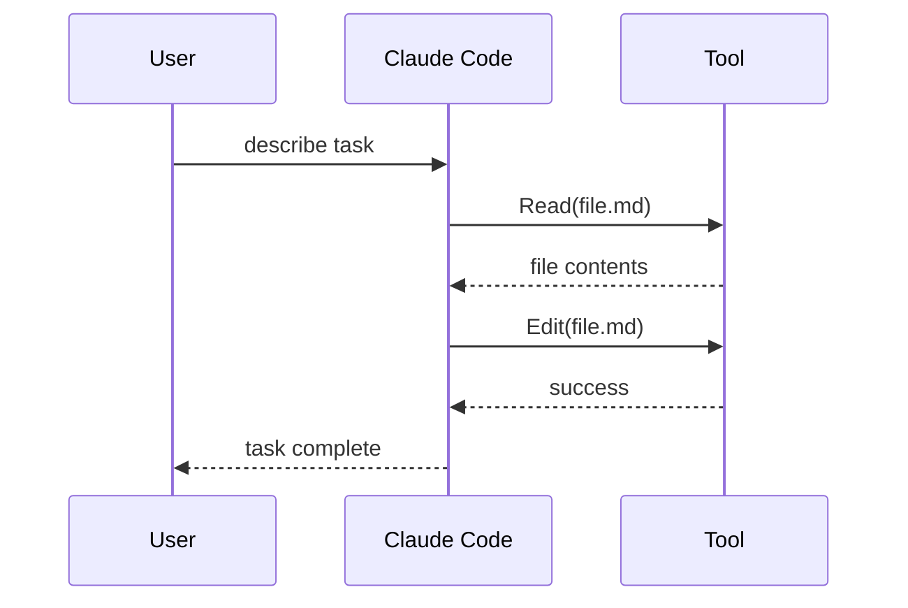

# Visualize Conversation Skill

Generate a Mermaid sequence diagram from Claude Code session data, showing user prompts, tool calls, and agent activity.

## How It Works

Claude Code does not produce structured session JSON automatically. Use this skill when you have a session log, conversation export, or `.conversation/data` artifacts (from a tool that captures session state) and want to render a Mermaid diagram from them.

## Workflow

### When session data exists

If `.conversation/data/` contains session files (from a hook or capture tool):

```powershell
cd .conversation
node ./scripts/visualize.js --session <id>
node ./scripts/visualize.js --list
```

Output is written to `.conversation/conversations/conv-{id}.md` as a Mermaid sequence diagram.

### When no session data exists

Construct the diagram manually from the conversation context:

1. Identify the main steps: user prompt, tool calls, agent dispatches, results
2. Write a `sequenceDiagram` block grouping these events chronologically
3. Include tool names, agent names, and key outputs as labels

Example structure:



## Delete Session Data

```powershell
cd .conversation
node ./scripts/visualize.js --delete --session <id>
node ./scripts/visualize.js --delete --session all
```

## Output Format

Each generated `conv-{sessionId}.md` contains:

- Session metadata (start/end time)
- Mermaid sequence diagram
- Tool execution metrics table

## When To Use

- After a complex session to produce shareable documentation
- To review what tools were called and in what order
- To identify bottlenecks or redundant calls in a session
